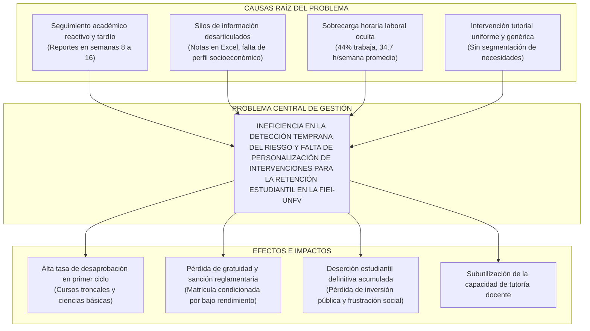
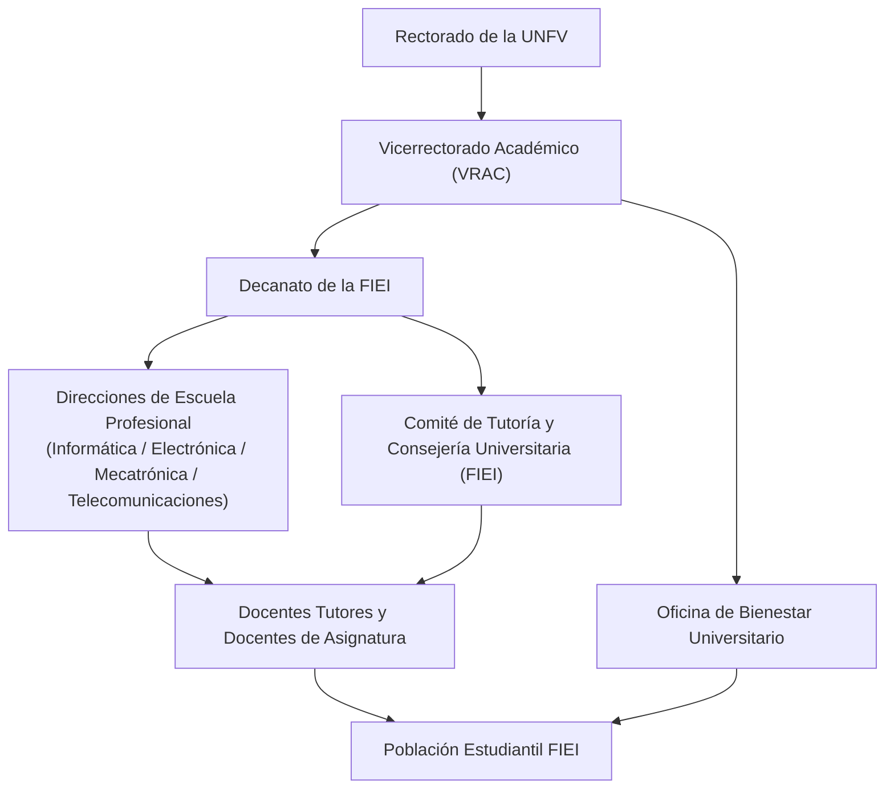
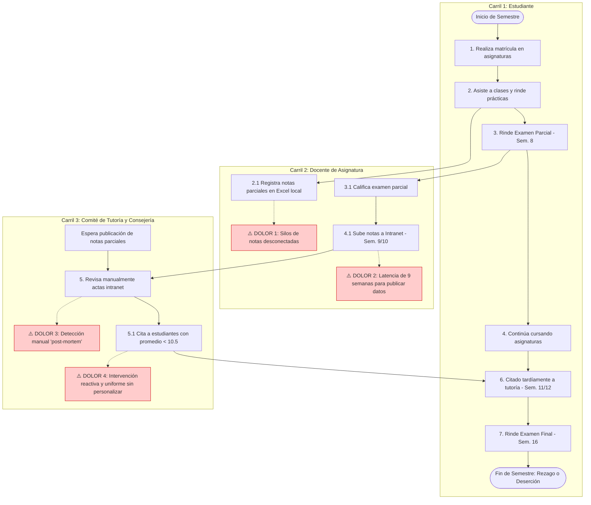
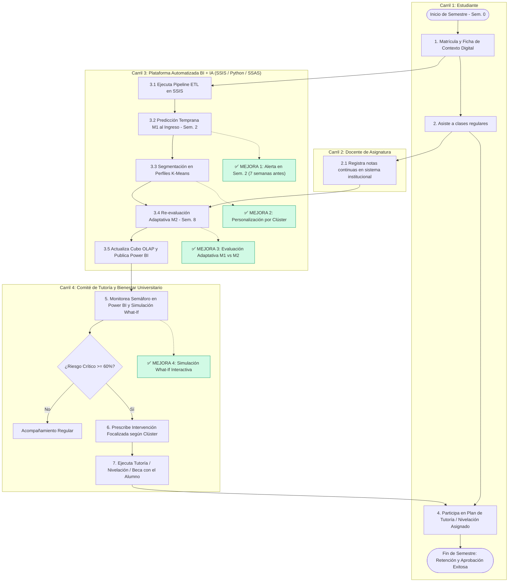
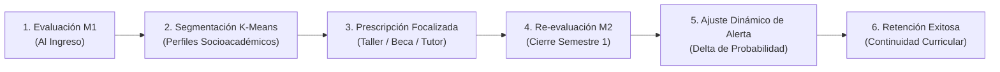

# INFORME ACADÉMICO – FASE 1 (HASTA EL CAPÍTULO II)

**UNIVERSIDAD NACIONAL FEDERICO VILLARREAL**  
**FACULTAD DE INGENIERÍA ELECTRÓNICA E INFORMÁTICA**  
**ESCUELA PROFESIONAL DE INGENIERÍA INFORMÁTICA / ELECTRÓNICA**

---

### PROYECTO INTEGRADOR AVANZADO
**SISTEMA INTELIGENTE DE EVALUACIÓN ADAPTATIVA Y PERSONALIZACIÓN DEL APRENDIZAJE UNIVERSITARIO**  
*Subtítulo:* Plataforma Integral de Business Intelligence y Machine Learning basada en DataMart Multidimensional, Pipelines SSIS, Cubos OLAP y Modelos Predictivos para la Gestión de Retención Académica en UNFV-FIEI

* **Curso:** Gestión y Análisis de Datos e Información
* **Docente:** Mg. Ing. Ivan Crispin Sanchez
* **Ciclo Académico:** 2026

---

## ÍNDICE GENERAL
1. [Introducción](#introducción)
   * 1.1. Presentación del proyecto
   * 1.2. Problema identificado
   * 1.3. Importancia de la solución
   * 1.4. Alcance general
2. [Capítulo I: Generalidades](#capítulo-i-generalidades)
   * 2.1. Descripción de la empresa u organización
   * 2.2. Historia, misión, visión y valores
   * 2.3. Organización y organigrama
   * 2.4. Área involucrada
   * 2.5. Descripción del proceso actual
   * 2.6. Diagrama AS-IS (Proceso Actual)
   * 2.7. Propuesta TO-BE (Proceso Futuro Optimizado)
3. [Capítulo II: Proyecto o Tarea Académica (Marco Teórico y Fundamentación)](#capítulo-ii-proyecto-o-tarea-académica)
   * 3.1. Inteligencia de Negocios (Business Intelligence)
   * 3.2. Data Warehouse y DataMart (Metodología Kimball)
   * 3.3. Modelos Dimensionales (Esquema Estrella)
   * 3.4. Datos, Información y Conocimiento (Pirámide DIKW)
   * 3.5. Dimensiones, Medidas, Jerarquías y Granularidad
   * 3.6. Cubos OLAP y Procesamiento Multidimensional (SSAS)
   * 3.7. Indicadores de Gestión y KPIs
   * 3.8. Machine Learning e Inteligencia Artificial en Educación (*Educational Data Mining*)
4. [Referencias Bibliográficas (Normas APA 7ma Edición)](#referencias-bibliográficas)

---

## INTRODUCCIÓN

### 1.1. Presentación del proyecto
En el escenario contemporáneo de la educación superior universitaria peruana, las instituciones enfrentan un desafío estructural determinante que compromete su sostenibilidad institucional, calidad educativa y responsabilidad social: la deserción estudiantil temprana y el rezago curricular no supervisado. El presente proyecto integrador diseña e implementa una **plataforma inteligente de Business Intelligence y Machine Learning**, concebida específicamente para superar el paradigma tradicional de reportes retrospectivos estáticos y hojas de cálculo desconectadas.

La arquitectura de la solución se estructura siguiendo estrictamente el flujo secuencial de siete etapas establecido por la cátedra de Gestión y Análisis de Datos e Información:
1. **Fuentes Transaccionales y Externas:** Integración del dataset académico granular de trayectoria estudiantil (UCI Machine Learning, 4,424 observaciones $\times$ 37 atributos), el catálogo universitario nacional (TUNI/SUNEDU) y los microdatos sociolaborales oficiales (ENAHO/INEI 2023, Módulos 300 y 500).
2. **Proceso de Extracción, Transformación y Carga (ETL):** Implementado mediante **Visual Studio SQL Server Integration Services (SSIS)**, garantizando áreas de preparación (*Staging*), normalización de calificaciones a la escala vigesimal peruana ($0\text{ a }20$) y controles rigurosos de calidad de datos.
3. **DataMart Relacional Dimensional:** Diseñado bajo metodología Ralph Kimball en **Microsoft SQL Server**, estructurando esquemas estrella con granularidad atómica por estudiante y etapa de evaluación.
4. **Procesamiento Analítico Multidimensional (OLAP):** Construido en **SQL Server Analysis Services (SSAS)** para habilitar operaciones analíticas multidimensionales (*Drill-down*, *Roll-up*, *Slice & Dice*) y cálculo de KPIs de gestión.
5. **Módulo Predictivo de Inteligencia Artificial:** Desarrollado en **Python (Scikit-Learn)**, ejecutando la comparación formal de algoritmos supervisados (**Regresión Logística vs. Random Forest**) en dos hitos temporales y segmentación no supervisada (**Clustering K-Means**) para perfiles estudiantiles.
6. **Integración BI + IA y Cuadros de Mando Ejecutivos:** Almacenamiento de probabilidades predichas en la base analítica y visualización interactiva en **Power BI Desktop**, incorporando un semáforo de riesgo y un simulador prescriptivo de escenarios (*What-If*).
7. **Toma de Decisiones Institucionales:** Entrega de información procesable y recomendaciones prescriptivas al Director de Escuela Profesional, Comité de Tutoría y Bienestar Universitario de la FIEI-UNFV.

Para asegurar la coherencia epistemológica del proyecto frente a su denominación oficial, se establecen las siguientes definiciones operativas:
* **Evaluación Adaptativa:** Proceso dinámico de re-evaluación del riesgo académico ejecutado en etapas sucesivas ($M_1$: Al ingreso vs. $M_2$: Al cierre del primer semestre), permitiendo que el sistema adapte su nivel de alerta conforme el estudiante genera evidencia real de rendimiento universitario.
* **Personalización del Aprendizaje:** Segmentación de la población estudiantil en perfiles socioacadémicos homogéneos mediante *Clustering*, articulada con una matriz de intervención tutorial que asigna planes pedagógicos diferenciados según el tipo y nivel de vulnerabilidad.

---

### 1.2. Problema identificado
La gestión académica tradicional en las universidades públicas adolece de un modelo de seguimiento netamente **reactivo y "post-mortem"**. Las señales de fracaso y abandono estudiantil son advertidas por las autoridades facultativas de manera tardía: comúnmente al consolidarse las actas oficiales de notas tras los exámenes parciales (semanas 8 a 10) o al concluir el semestre académico (semana 16). En este punto crítico, las posibilidades pedagógicas y administrativas de recuperación o nivelación son prácticamente nulas, consolidando la desaprobación masiva y el abandono.

En el sistema universitario peruano, esta problemática presenta una severa raíz socioeconómica y laboral. El análisis de microdatos de la Encuesta Nacional de Hogares (INEI ENAHO 2023, Módulos 300 y 500) revela que:
* El **$44.0\%$ de los estudiantes universitarios peruanos se encuentra trabajando activamente** durante sus estudios de pregrado.
* La jornada laboral promedio entre los estudiantes trabajadores alcanza **$34.7$ horas semanales**, configurando un régimen de sobrecarga horaria incompatible con la alta demanda de créditos académicos.
* En el ámbito nacional, la Superintendencia Nacional de Educación Superior Universitaria (SUNEDU) reporta que la deserción interanual en el primer año formativo oscila entre el **$18\%$ y el $27\%$**, afectando con mayor severidad a las carreras de ciencias básicas e ingeniería.
* En el contexto específico de la UNFV, investigaciones empíricas recientes realizadas por docentes de la institución (Aparicio-Montenegro et al., 2026) confirman que más del $70\%$ de los casos de desvinculación definitiva en la universidad se incuban durante los dos primeros semestres por desaprobación acumulada en cursos troncales.
* Como referencia empírica benchmark, el dataset internacional de estudio (Realinho et al., 2022) refleja una tasa de abandono histórico acumulado del **$32.1\%$** frente a un **$17.9\%$** de matrícula rezagada persistente, demostrando que la falta de intervención temprana condena a casi la mitad de los estudiantes vulnerables al fracaso académico.

---

### 1.3. Importancia de la solución
La implementación de esta plataforma inteligente aporta un valor estratégico multidimensional a la gestión académica, alineando las capacidades analíticas con las necesidades operativas de cada actor del proceso:

| Actor Beneficiario | Necesidad Crítica Resuelta | Beneficio Concreto Entregado | Componente Tecnológico Responsable |
| :--- | :--- | :--- | :--- |
| **Director de Escuela Profesional** | Carencia de visión agregada de retención y rendimiento curricular por cohorte. | Tableros ejecutivos con KPIs consolidados por escuela para optimizar la oferta curricular y la asignación docente. | DataMart en SQL Server + Cubo SSAS + Power BI |
| **Comité de Tutoría y Consejería** | Detección tardía de estudiantes reprobatorios y saturación tutorial. | Semáforo de riesgo predictivo antes de la semana 5 que prioriza a los estudiantes en riesgo crítico ($P \ge 60\%$). | Modelos Supervisados de IA (Python) + `FactPrediccion` |
| **Docente Tutor / Consejero** | Desconocimiento del perfil específico y motivos de rezago del alumno. | Ficha individual del estudiante con perfil socioacadémico y recomendación prescriptiva adaptada a su vulnerabilidad. | Clustering K-Means + Matriz de Recomendación |
| **Oficina de Bienestar Universitario** | Asignación asistencial desarticulada del rendimiento real. | Identificación cruzada de estudiantes en riesgo académico con sobrecarga laboral o precariedad económica para otorgar becas comedor. | Contexto ENAHO integrado + Dashboard de Bienestar |
| **Estudiante Universitario** | Acompañamiento pedagógico tardío e intervenciones impersonales. | Alerta y nivelación académica preventiva antes de caer en causal de matrícula condicionada o deserción. | Plan de Intervención Personalizado |

---

### 1.4. Alcance general y delimitación técnica

#### 1.4.1. Objetivo General
Diseñar e implementar una plataforma inteligente de Business Intelligence y Machine Learning basada en arquitectura de DataMart relacional, pipelines de integración SSIS, cubos analíticos SSAS y cuadros de mando interactivos en Power BI, orientada a la evaluación adaptativa del riesgo académico y la personalización de intervenciones para la retención estudiantil en la FIEI-UNFV.

#### 1.4.2. Objetivos Específicos
1. Modelar los procesos académicos AS-IS y TO-BE de la FIEI-UNFV, diagnosticando los puntos de latencia informacional y formalizando el catálogo de preguntas de negocio y KPIs institucionales.
2. Diseñar e implementar el DataMart dimensional en SQL Server bajo esquema estrella (metodología Ralph Kimball), estructurando tablas de hechos y dimensiones conformadas con niveles rigurosos de granularidad.
3. Construir el pipeline ETL automatizado mediante Visual Studio SQL Server Integration Services (SSIS), asegurando áreas de *staging*, transformación de datos, normalización vigesimal ($0\text{ a }20$) y auditoría de carga.
4. Desarrollar y evaluar comparativamente los modelos de Machine Learning en Python (Regresión Logística vs. Random Forest) en dos momentos temporales y segmentar perfiles estudiantiles mediante Clustering K-Means.
5. Implementar el Cubo OLAP multidimensional en SSAS y desarrollar el Dashboard inteligente en Power BI Desktop, integrando el semáforo predictivo y un simulador de escenarios *What-If*.

#### 1.4.3. Matriz de Alcance Positivo y Negativo
* **Lo que el proyecto SÍ incluye:** Procesamiento y limpieza de 4,424 registros granulares, modelado dimensional en SQL Server, ETL en Visual Studio SSIS, cubo OLAP en SSAS, modelado predictivo supervisado en dos etapas ($M_1$ y $M_2$), validación *out-of-fold* para toda la población en Power BI, y simulación de escenarios What-If.
* **Lo que el proyecto NO incluye (Límites declarados):** No incluye desarrollo de sistemas web full-stack ni apps móviles; no implementa tests adaptativos computarizados a nivel de reactivo (CAT/TRI); y no realiza cruces nominativos ficticios entre estudiantes de UCI y encuestados de ENAHO/TUNI, preservando la trazabilidad y la legalidad de los datos.

---

## CAPÍTULO I: GENERALIDADES

### 2.1. Descripción de la empresa u organización
El marco organizacional del presente proyecto es la **Universidad Nacional Federico Villarreal (UNFV)**, institución pública de educación superior universitaria del Perú, focalizando su implementación y caso de negocio en la **Facultad de Ingeniería Electrónica e Informática (FIEI)**.

La UNFV cuenta con **Licenciamiento Institucional otorgado por la SUNEDU** mediante la **Resolución del Consejo Directivo N° 035-2019-SUNEDU/CD** (emitida el 11 de marzo de 2019), la cual acreditó el cumplimiento de las Condiciones Básicas de Calidad (CBC) exigidas por la Ley Universitaria N° 30220.

La FIEI concentra la formación tecnológica y científica de vanguardia de la universidad, albergando cuatro escuelas profesionales:
1. **Escuela Profesional de Ingeniería Informática:** Especializada en ingeniería de software, analítica de datos, sistemas de información y seguridad informática.
2. **Escuela Profesional de Ingeniería Electrónica:** Centrada en sistemas electrónicos, instrumentación y procesamiento digital de señales.
3. **Escuela Profesional de Ingeniería Mecatrónica:** Orientada al control automático, robótica industrial y sistemas ciberfísicos.
4. **Escuela Profesional de Ingeniería de Telecomunicaciones:** Focalizada en redes convergentes, sistemas de transmisión y radiocomunicaciones.

| Atributo | Detalle Oficial Institucional |
| :--- | :--- |
| **Denominación Oficial** | Universidad Nacional Federico Villarreal (UNFV) |
| **Dependencia Piloto** | Facultad de Ingeniería Electrónica e Informática (FIEI) |
| **Ubicación de la FIEI** | Jr. Iquique N° 127, Breña, Lima, Perú |
| **Tipo de Gestión** | Universidad Pública del Estado Peruano |
| **Estado de Licenciamiento** | Licenciada (Resolución del Consejo Directivo N° 035-2019-SUNEDU/CD) |
| **Población Académica FIEI** | ~2,200 estudiantes de pregrado matriculados en sus cuatro escuelas |
| **Régimen de Evaluación** | Semestral (16 semanas por ciclo académico) con escala vigesimal ($0\text{ a }20$) |

---

### 2.2. Historia, misión, visión y valores

#### 2.2.1. Reseña Histórica Oficial
La Universidad Nacional Federico Villarreal fue creada mediante la **Ley N° 14692**, promulgada el **30 de octubre de 1963**, a partir de la filial en Lima de la Universidad Comunal del Centro del Perú. Nombrada en honor al insigne matemático, físico e ingeniero peruano Federico Villarreal, la institución ha cumplido más de seis décadas formando profesionales e investigadores. La FIEI fue constituida como unidad académica autónoma para liderar la investigación y la transferencia tecnológica en tecnologías de la información, electrónica y computación.

#### 2.2.2. Misión Institucional (Estatuto y PEI UNFV Vigente)
> *"Formar profesionales e investigadores competitivos, con sólidos valores éticos, humanísticos, científicos y tecnológicos, comprometidos con el desarrollo sostenible del país."*

#### 2.2.3. Visión Institucional (Estatuto y PEI UNFV Vigente)
> *"Ser una universidad pública licenciada y acreditada internacionalmente, líder en la formación integral de excelencia e investigación innovadora de alto impacto social."*

#### 2.2.4. Valores Institucionales
* **Ética e Integridad:** Actuación basada en la honestidad académica y veracidad científica.
* **Rigor Científico y Excelencia:** Compromiso con la exactitud metodológica y la calidad técnica.
* **Responsabilidad Social:** Búsqueda permanente de la equidad y apoyo a los sectores estudiantiles vulnerables.
* **Transparencia:** Gestión sustentada en datos abiertos y rendición de cuentas orientada a resultados.

#### 2.2.5. Alineamiento Estratégico del Proyecto con la Misión y Visión
| Elemento Estratégico UNFV | Compromiso Institucional Declarado | Cómo lo Cumple y Apoya este Proyecto de BI + IA |
| :--- | :--- | :--- |
| **Misión: "Formar profesionales competitivos..."** | Asegurar que los estudiantes culminen con éxito sus planes curriculares. | El sistema previene el rezago curricular y el abandono en cursos troncales, asegurando la continuidad del proceso formativo. |
| **Visión: "Formación de excelencia e investigación..."** | Acreditación y cumplimiento continuo de estándares de permanencia. | Entrega indicadores objetivos de retención para sustentar auditorías de calidad educativa y acreditación de las escuelas de la FIEI. |
| **Valores: "Responsabilidad Social y Equidad..."** | Evitar que factores económicos y laborales trunquen la vocación universitaria. | Articula el perfil laboral del estudiante con recomendaciones tutoriales y focalización de becas de Bienestar Universitario. |

---

### 2.3. Organización y organigrama

La estructura jerárquica de la UNFV y la articulación de las dependencias que participan en la gestión del rendimiento estudiantil se formaliza a continuación:

---

### 2.4. Área involucrada y matriz de responsabilidades (RACI)

El proceso de seguimiento y retención involucra a dependencias de carácter académico, tutorial y asistencial bajo el mandato de los artículos 126 y 128 de la **Ley Universitaria N° 30220**, que establecen la obligatoriedad de la tutoría universitaria y los servicios de bienestar:

| Actividad / Proceso Analítico | Director de Escuela | Comité de Tutoría | Docente Tutor | Bienestar Univ. | Plataforma BI+IA |
| :--- | :---: | :---: | :---: | :---: | :---: |
| Consolidación de datos de matrícula y notas (ETL) | **I** | **I** | **I** | **I** | **R / A** |
| Emisión y monitoreo del semáforo de riesgo predictivo | **A** | **R** | **C** | **I** | **R** |
| Asignación de estudiantes críticos a tutores | **A** | **R** | **I** | **C** | **Soporte** |
| Ejecución de sesiones tutoriales y nivelación académica | **I** | **A** | **R** | **C** | **Soporte** |
| Asignación de becas y asistencias socioeconómicas | **I** | **C** | **C** | **R / A** | **Soporte** |
| Evaluación global de KPIs y simulación What-If | **R / A** | **C** | **I** | **I** | **Soporte** |

*Leyenda RACI: **R** = Responsable de ejecución, **A** = Aprobador final / Dueño, **C** = Consultado, **I** = Informado.*

---

### 2.5. Descripción del proceso actual (AS-IS)
En el régimen operativo actual, el seguimiento académico del estudiante en la FIEI-UNFV se realiza de forma **desarticulada, manual y reactiva**. El ciclo académico comprende 16 semanas lectivas, estructurándose de la siguiente forma:

| N° | Actividad | Actor Principal | Insumo | Salida | Semana / Momento | Problema / Cuello de Botella Detectado |
| :---: | :--- | :--- | :--- | :--- | :---: | :--- |
| **1** | Matrícula regular | Estudiante | Ficha de matrícula | Padrón de inscritos | Semana 0 | Solo registra asignaturas matriculadas; no captura situación laboral ni horas de trabajo del alumno. |
| **2** | Desarrollo de clases y prácticas | Docente | Registro auxiliar | Calificaciones en Excel | Semanas 1 a 7 | Las notas de prácticas se quedan en computadoras personales de los profesores; no suben al sistema central. |
| **3** | Exámenes parciales | Docente / Alumno | Examen físico | Actas preliminares | Semana 8 | Primer punto formal de evaluación; el alumno ya acumula 2 meses de rezago sin que nadie lo advierta. |
| **4** | Carga oficial de notas parciales | Docente | Intranet docente | Acta consolidada en BD | Semanas 9 a 10 | **Latencia informacional severa:** Frecuentes demoras de los docentes en digitar notas a la intranet. |
| **5** | Identificación de casos críticos | Comité Tutoría | Reporte manual intranet | Lista en papel/hoja Excel | Semanas 10 a 11 | El comité revisa manualmente promedios $< 10.5$; labor lenta y sin criterios de priorización predictiva. |
| **6** | Citación a tutoría correctiva | Docente Tutor | Lista de citados | Sesión de asesoría | Semanas 11 a 12 | **Acción tardía:** El alumno es citado cuando ya desaprobó con notas irrecuperables ($05$ a $08$). |
| **7** | Examen final y cierre de actas | Docente | Sistema de actas | Condición final aprobada | Semanas 16 a 17 | Se constata el fracaso académico; el estudiante repite o cae en causal de matrícula condicionada (Ley 30220). |

---

### 2.6. Diagrama AS-IS (Proceso Actual)

#### 2.6.1. Diagrama de Flujo Visual (Flujo con Carriles y Puntos de Dolor)

#### 2.6.2. Guía Técnica Paso a Paso para Modelado en Bizagi Modeler (AS-IS)
Para construir el diagrama oficial BPMN 2.0 en Bizagi Modeler y exportarlo al informe final:
1. **Crear Pool Principal:** Nombrar el proceso como `"Proceso AS-IS: Seguimiento Académico Tradicional en FIEI-UNFV"`.
2. **Crear 3 Lanes (Carriles de Nado):**
   * *Lane 1:* `Estudiante`
   * *Lane 2:* `Docente de Asignatura`
   * *Lane 3:* `Comité de Tutoría y Consejería`
3. **Insertar Elementos BPMN en cada Lane:**
   * **En Lane Estudiante:**
     * Evento de Inicio (Círculo verde fino): `"Inicio del Semestre Académico"`.
     * Tarea de Usuario (👤): `"Realizar Matrícula Regular"`.
     * Tarea de Usuario (👤): `"Asistir a Clases y Rendir Evaluaciones"`.
     * Tarea de Usuario (👤): `"Rendir Examen Parcial (Semana 8)"`.
     * Tarea de Usuario (👤): `"Rendir Examen Final (Semana 16)"`.
     * Evento de Fin (Círculo rojo grueso): `"Deserción o Repitencia Consumada"`.
   * **En Lane Docente de Asignatura:**
     * Tarea Manual (✍️): `"Calificar Prácticas en Registro Auxiliar Excel"`.
     * Objeto de Datos (Documento con esquina doblada): `"Archivo Excel Aislado"`.
     * Tarea de Usuario (👤): `"Digitar Calificaciones en Intranet (Semanas 9-10)"`.
   * **En Lane Comité de Tutoría:**
     * Tarea de Usuario (👤): `"Revisar Manualmente Actas en Intranet"`.
     * Compuerta Exclusiva ($\times$): `"¿Promedio < 10.5?"`.
       * Rama No: Flujo de secuencia hacia fin normal del semestre.
       * Rama Sí: Tarea de Usuario `"Citar a Estudiante a Tutoría Correctiva (Semana 11-12)"`.
4. **Insertar Anotaciones de Texto (Puntos de Dolor en Bizagi):**
   * *Anotación 1 (vinculada a Registro Excel):* `"[DOLOR 1] Información aislada sin integración central"`.
   * *Anotación 2 (vinculada a Digitar Notas):* `"[DOLOR 2] Latencia de 9 semanas en consolidación de datos"`.
   * *Anotación 3 (vinculada a Revisar Actas):* `"[DOLOR 3] Detección tardía (post-mortem)"`.
   * *Anotación 4 (vinculada a Citar Estudiante):* `"[DOLOR 4] Intervención sin diagnóstico de causas de fondo"`.

---

### 2.7. Propuesta TO-BE (Proceso Futuro Optimizado)

#### 2.7.1. Diagrama de Flujo Visual (Flujo BPMN con Carriles y Mejoras Estratégicas)

#### 2.7.2. Guía Técnica Paso a Paso para Modelado en Bizagi Modeler (TO-BE)
1. **Crear Pool Principal:** `"Proceso TO-BE: Sistema Inteligente de Evaluación Adaptativa y Personalización Académica"`.
2. **Crear 4 Lanes en Bizagi:**
   * *Lane 1:* `Estudiante`
   * *Lane 2:* `Docente de Asignatura`
   * *Lane 3:* `Plataforma Automatizada BI + IA (SSIS / SQL Server / Python / Power BI)`
   * *Lane 4:* `Comité de Tutoría y Bienestar Universitario`
3. **Insertar Elementos BPMN en cada Lane:**
   * **Lane Estudiante:**
     * Evento de Inicio: `"Inicio de Ciclo Académico (Semana 0)"`.
     * Tarea de Usuario (👤): `"Completar Matrícula y Ficha de Contexto Digital"`.
     * Tarea de Usuario (👤): `"Cursar Asignaturas con Soporte Continuo"`.
     * Tarea de Usuario (👤): `"Participar en Plan de Nivelación / Tutoría Asignada"`.
     * Evento de Fin: `"Retención Exitosa y Continuidad Curricular"`.
   * **Lane Docente de Asignatura:**
     * Tarea de Usuario (👤): `"Registrar Calificaciones Continuas en Sistema Centralizado"`.
   * **Lane Plataforma Automatizada BI + IA:**
     * Tarea de Servicio (⚙️): `"Ejecutar Pipeline ETL Automatizado (Visual Studio SSIS)"`.
     * Tarea de Servicio (⚙️): `"Calcular Probabilidad de Abandono (Momento 1: Ingreso - Python ML)"`.
     * Tarea de Servicio (⚙️): `"Segmentar Estudiantes en Perfiles Socioacadémicos (K-Means)"`.
     * Tarea de Servicio (⚙️): `"Re-evaluar Riesgo Adaptativamente (Momento 2: Cierre S1 - Python ML)"`.
     * Tarea de Servicio (⚙️): `"Poblar dw.FactPrediccion y Actualizar Cubo SSAS"`
     * Tarea de Envío / Servicio (⚙️): `"Publicar Dashboard Power BI y Emitir Alertas Tempranas"`.
   * **Lane Comité de Tutoría y Bienestar Universitario:**
     * Tarea de Usuario (👤): `"Monitorear Semáforo Predictivo y Simular Escenarios What-If en Power BI"`.
     * Compuerta Exclusiva ($\times$): `"¿Riesgo Crítico (P >= 60%)?"`.
     * Tarea de Regla de Negocio (📋): `"Prescribir Intervención Personalizada según Matriz de Recomendación"`.
     * Tarea de Usuario (👤): `"Asignar y Ejecutar Tutoría / Ayuda Socioeconómica con el Estudiante"`.
4. **Insertar Anotaciones de Mejora en Bizagi:**
   * *Anotación M1:* `"[MEJORA 1] Detección temprana en semana 2 sin esperar al examen parcial"`.
   * *Anotación M2:* `"[MEJORA 2] Evaluación adaptativa por hitos cronológicos (M1 y M2)"`.
   * *Anotación M3:* `"[MEJORA 3] Intervención prescrita a la medida del perfil (Clustering)"`.
   * *Anotación M4:* `"[MEJORA 4] Simulador What-If para dimensionar la capacidad tutorial"`.

---

### 2.8. Matriz Comparativa Exhaustiva: Proceso AS-IS vs. Proceso TO-BE

| Dimensión de Análisis | Situación Actual (AS-IS) | Situación Propuesta (TO-BE) | Componente Tecnológico Responsable | KPI Asociado de Impacto |
| :--- | :--- | :--- | :--- | :--- |
| **Tiempo de Detección (Latencia)** | **Semana 9 a 11:** Tras digitar exámenes parciales. Detección reactiva ("post-mortem"). | **Semana 2 a 4 ($M_1$):** Diagnóstico preliminar al ingreso y re-evaluación adaptativa en $M_2$. | Pipelines SSIS + Modelo Predictivo en Python | Tiempo de respuesta $\le 4$ semanas; Recall $\ge 75\%$. |
| **Integración de Fuentes de Datos** | Hojas de cálculo Excel aisladas en PCs de docentes; intranet desarticulada. | **DataMart Centralizado en SQL Server:** Ingesta de datos de trayectoria, catálogo y contexto ENAHO. | Pipeline ETL en Visual Studio SSIS | 100% de fuentes integradas; 0 duplicados en DataMart. |
| **Criterio de Identificación del Riesgo** | Promedio aritmético simple post examen ($< 10.5$) sin análisis predictivo multivariable. | **Modelo Multivariable de Machine Learning (Random Forest):** Cálculo de probabilidad continua de abandono. | Algoritmos Supervisados (`FactPrediccion`) | $F_1$-Macro $\ge 0.65$; ROC-AUC $\ge 0.85$. |
| **Enfoque de la Evaluación** | Estática y finalista; sin seguimiento temporal de la evolución del riesgo. | **Evaluación Adaptativa Dinámica:** Re-evaluación del riesgo en dos hitos ($M_1$ Ingreso vs. $M_2$ Cierre S1). | `dw.DimEtapa` en DataMart + Cubo SSAS | Variación del riesgo entre etapas ($\Delta P$). |
| **Estrategia de Intervención** | Genérica y uniforme para todos los reprobados (sanción o aviso estándar). | **Personalización por Perfiles:** Prescripción diferenciada según clúster socioacadémico identificado. | Clustering K-Means + Matriz de Recomendación | Índice Silhouette $\ge 0.35$; Cobertura de tutoría. |
| **Herramienta de Consumo** | Actas impresas en papel y listados planos en Excel no interactivos. | **Dashboard Inteligente en Power BI Desktop:** Semáforo predictivo interactivo y simulador What-If. | Power BI Desktop | 100% de actores consultando información en tiempo real. |
| **Planificación Institucional** | Empírica; sin capacidad de proyectar el impacto de las políticas de tutoría. | **Simulación Interactiva What-If:** Análisis de escenarios modificando umbral, cobertura y efectividad. | Parámetros What-If en Power BI | Estudiantes Proyectados Retenidos (KPI-10). |

---

## CAPÍTULO II: MARCO TEÓRICO Y FUNDAMENTACIÓN CIENTÍFICA

El presente capítulo establece los fundamentos teóricos, metodológicos y tecnológicos que sustentan el diseño e implementación del *Sistema Inteligente de Evaluación Adaptativa y Personalización del Aprendizaje Universitario*. Conforme a las exigencias académicas de la cátedra, cada sección se estructura en dos componentes complementarios: (1) fundamentación conceptual respaldada por literatura científica indexada y obras clásicas de la disciplina, y (2) justificación y aplicación directa en los artefactos del sistema.

---

### 2.0. Antecedentes de la Investigación

La predicción del rendimiento y la retención estudiantil mediante Inteligencia de Negocios y Aprendizaje Automático constituye un campo consolidado en la literatura internacional y nacional. A continuación, se sintetizan las investigaciones científicas directamente vinculadas a la problemática y arquitectura del proyecto:

| N° | Autores y Año | Contexto y Muestra | Metodología / Técnicas de IA | Métricas Clave Obtenidas | Aporte Concreto Adoptado en este Proyecto |
| :---: | :--- | :--- | :--- | :--- | :--- |
| **01** | **Realinho et al. (2022)** | Instituto Politécnico de Portalegre (4,424 estudiantes, 37 atributos). | Random Forest, Gradient Boosting, CatBoost, SMOTE. | Accuracy: 77.1% (3 clases) y 87.2% (binario); F1-macro: 0.64–0.77. | **Paper fundacional del dataset de referencia:** Provee la selección de variables de admisión y trayectoria, y la formulación multiclase (`Dropout`, `Enrolled`, `Graduate`). |
| **02** | **Aparicio-Montenegro et al. (2026)** | **UNFV (Universidad Nacional Federico Villarreal, Perú)**, muestra institucional de pregrado. | Random Forest, Regresión Logística, Árboles C4.5, Naive Bayes. | RF Accuracy: 86.2%; Recall: 83.5%; F1-score: 0.84. | **Evidencia empírica directa de la UNFV:** Valida la superioridad de Random Forest en la población estudiantil villarrealina y justifica la prioridad del Recall en alertas tempranas. |
| **03** | **Aco Tito et al. (2023)** | Universidad Nacional de San Agustín (UNSA, Perú). | Random Forest, Regresión Logística, SVM, Árboles CART. | RF Accuracy: 84.7%, F1: 0.83; LR Accuracy: 78.2%, F1: 0.76. | **Antecedente nacional universitario:** Fundamenta la comparación técnica formal entre Regresión Logística (baseline) y Random Forest exigida en la rúbrica. |
| **04** | **Almalawi et al. (2026)** | Educación Superior Internacional (evaluación formativa adaptativa). | Modelos lineales generalizados, clustering adaptativo, árboles multivariados. | F1-Score: 0.79; Precisión adaptativa: 82.4%. | **Pilar de Evaluación Adaptativa:** Fundamenta la Decisión D2: re-evaluación dinámica del riesgo por etapas temporales ($M_1$ Ingreso vs. $M_2$ Cierre del Primer Semestre). |
| **05** | **Hidayat et al. (2026)** | Análisis longitudinal de cohortes universitarias. | Random Forest, XGBoost, CatBoost, Regresión Logística, SMOTE-ENN. | RF ROC-AUC: 0.884; Recall Dropout: 84.1%; F1: 0.812. | **Pilar Analítica Prescriptiva y What-If:** Sustenta el simulador interactivo de escenarios What-If en Power BI variando umbrales de riesgo y efectividad de tutoría. |
| **06** | **Ali (2026)** | Prince Sattam bin Abdulaziz University (PSAU). | Ensemble Stacking (RF + Gradient Boosting), SHAP values, XAI. | Accuracy: 88.6%; Recall: 86.4%; F1: 87.1%; AUC: 0.912. | **Pilar de IA Explicable y Soporte Decisional:** Valida la articulación de modelos de Machine Learning con cuadros de mando ejecutivos para directores y comités tutoriales. |
| **07** | **Navarro Peñaranda et al. (2025)** | Facultad de Ingeniería de universidad pública (Colombia). | Regresión Logística binaria y árboles CART. | Accuracy: 79.3%; Odds Ratio (OR) en ciencias básicas = 3.42 (p < 0.01). | **Alineación con Facultades de Ingeniería:** Confirma que el rezago crítico en ingeniería se concentra en cursos troncales (Cálculo y Física), orientando la personalización. |
| **08** | **Schmidt (2023)** | Universidad estatal chilena (análisis longitudinal de cohortes). | Modelos de Supervivencia de Kaplan-Meier y Regresión de Cox. | 73.8% de deserciones concentradas en los dos primeros semestres (HR = 2.87). | **Justificación de Hitos Temporales:** Sustenta por qué el sistema concentra sus dos momentos de corte analítico ($M_1$ y $M_2$) en la transición del primer año académico. |

---

### 2.1. Inteligencia de Negocios (Business Intelligence)

#### 2.1.1. Fundamentación Teórica
La Inteligencia de Negocios (BI) se define como el conjunto integral de arquitecturas, tecnologías, procesos y metodologías que permiten transformar datos transaccionales heterogéneos y dispersos en información estructurada, significativa y directamente aplicable a la toma de decisiones estratégicas, tácticas y operativas (Chaudhuri & Dayal, 1997; Sharda et al., 2020). De acuerdo con Golfarelli y Rizzi (2009), el ciclo de vida de la Inteligencia de Negocios comprende cinco fases fundamentales:
1. **Extracción e integración:** Captura de datos desde sistemas operacionales transaccionales (OLTP) y fuentes externas.
2. **Limpieza y transformación (Staging):** Estandarización de formatos, tratamiento de datos nulos y normalización según reglas de calidad del negocio.
3. **Modelado y almacenamiento:** Carga en almacenes de datos estructurados dimensionalmente (Data Warehouse / DataMart).
4. **Análisis analítico multidimensional:** Procesamiento OLAP (*Online Analytical Processing*) que permite cálculos agregados instantáneos.
5. **Visualización y consumo:** Publicación en paneles ejecutivos interactivos (*Dashboards*) que soportan la monitorización de indicadores clave de rendimiento (KPIs) (Martín-Caro Álamo & Segovia-García, 2025).

#### 2.1.2. Aplicación Concreta en el Proyecto
En la gestión académica tradicional de la FIEI-UNFV, la información se encuentra fragmentada en registros personales de docentes y reportes planos de intranet. La implementación de la plataforma de BI unifica estas fuentes en una arquitectura gobernada:

| Componente de BI | Tecnología / Herramienta Seleccionada | Artefacto Concreto en el Proyecto |
| :--- | :--- | :--- |
| **Capa Transaccional / Fuente** | Archivos CSV planos y extractos relacionales | Datos de trayectoria académica (UCI Benchmark), contexto socioeconómico (ENAHO 2023) y catálogo institucional (TUNI SUNEDU). |
| **Extracción y Transformación** | Visual Studio SQL Server Integration Services (SSIS) | Proyecto `ETL_UNFV_Retencion.sln` con paquetes independientes para carga de Staging, Dimensiones y Hechos. |
| **Almacenamiento Dimensional** | Microsoft SQL Server (Motor Relacional) | Base de datos `DM_RetencionAcademica_FIEI` con esquemas segregados `stg`, `dw` y `audit`. |
| **Capa Semántica y OLAP** | Microsoft SQL Server Analysis Services (SSAS) | Cubo Multidimensional `Cubo_RiesgoAcademico.asdatabase` con medidas precalculadas en MDX y DAX. |
| **Capa de Consumo y Visualización** | Microsoft Power BI Desktop | Dashboard interactivo `Dashboard_Retencion_FIEI.pbix` estructurado en 4 páginas con navegación ejecutiva y simulador What-If. |

---

### 2.2. Data Warehouse y DataMart (Metodología Kimball)

#### 2.2.1. Fundamentación Teórica: Inmon vs. Kimball
En la ingeniería de almacenes de datos coexisten dos paradigmas arquitectónicos consolidados:
* **El enfoque corporativo Top-Down (Bill Inmon - Corporate Information Factory):** Plantea la construcción previa de un Data Warehouse corporativo unificado, altamente normalizado en Tercera Forma Normal (3FN), a partir del cual se desprenden posteriormente DataMarts temáticos dependientes. Si bien asegura máxima consistencia global, demanda tiempos excesivos de diseño e inversión institucional que dificultan entregas ágiles.
* **El enfoque dimensional Bottom-Up (Ralph Kimball - Dimensional Data Warehouse):** Plantea la construcción evolutiva e incremental de **DataMarts orientados a procesos de negocio específicos**, diseñados directamente bajo modelado dimensional (esquemas estrella o constelación), los cuales se integran horizontalmente mediante el uso riguroso de **Dimensiones Conformadas** (*Conformed Dimensions*) a través de una Matriz Bus de Negocio (Kimball & Ross, 2013).

#### 2.2.2. Decisión de Ingeniería y Aplicación en el Proyecto
**Se adopta formalmente el enfoque Bottom-Up de Ralph Kimball.**  
*Justificación Metodológica:* El alcance del proyecto está delimitado al proceso de negocio prioritario de la FIEI: *"Seguimiento Académico, Alerta Temprana y Retención Estudiantil"*. Implementar un Data Warehouse corporativo para toda la universidad requeriría integrar nóminas docentes, infraestructura física, compras y presupuesto estatal, lo cual desvirtuaría los objetivos del curso. El diseño de un **DataMart Departamental** en SQL Server asegura una arquitectura ágil, granular y optimizada para consultas analíticas de lectura masiva.

Para garantizar la integridad y auditoría del flujo de datos, se definen tres esquemas lógicos segregados dentro de la base de datos:
1. `stg` (**Staging Area**): Área de aterrizaje volátil donde los datos en bruto se insertan sin restricciones de clave foránea para su perfilado y limpieza.
2. `dw` (**DataMart Dimensional**): Área de producción analítica donde residen las tablas de dimensiones conformadas y las tablas de hechos con integridad referencial estricta.
3. `audit` (**Auditoría y Trazabilidad**): Almacena bitácoras de ejecución de los paquetes SSIS, registrando timestamps, conteo de filas leídas, cargadas y rechazadas.

---

### 2.3. Modelos Dimensionales y Matriz Bus

#### 2.3.1. Fundamentación Teórica
El modelado dimensional estructura los datos en dos clases de tablas:
* **Tablas de Hechos (Fact Tables):** Representan eventos de negocio cuantitativos numéricos (medidas). Contienen claves foráneas hacia las dimensiones y métricas asociadas al evento.
* **Tablas de Dimensiones (Dimension Tables):** Representan el contexto del negocio (*quién, qué, cuándo, dónde y por qué*). Contienen atributos descriptivos textuales utilizados para filtrar, agrupar y rotar la información.

Los esquemas dimensionales estándar se clasifican en:
* *Esquema Estrella (Star Schema):* Estructura donde una tabla de hechos central se conecta directamente a tablas de dimensiones completamente desnormalizadas en un único nivel.
* *Esquema Copo de Nieve (Snowflake Schema):* Normaliza parcialmente las dimensiones en subtables jerárquicas, reduciendo redundancia a costa de degradar el rendimiento por excesivos `JOIN`.
* *Esquema Constelación de Hechos (Fact Constellation Schema):* Arquitectura avanzada donde **múltiples tablas de hechos** coexisten e interactúan compartiendo dimensiones conformadas comunes.

#### 2.3.2. Decisión de Ingeniería y Matriz Bus Preliminar
**Se implementa una Constelación de Hechos (Fact Constellation).**  
*Justificación:* El proceso analítico requiere modelar dos realidades con periodicidades y granos distintos: el progreso académico transaccional (notas y créditos) y las inferencias generadas por la Inteligencia Artificial (probabilidades y clústeres). Intentar consolidar ambos conceptos en una sola tabla de hechos violaría la regla fundamental del grano de Kimball.

A continuación, se formaliza la **Matriz Bus Preliminar (Kimball Bus Matrix)** que articula las tablas de hechos con las dimensiones conformadas:

| Proceso de Negocio / Tabla de Hechos | `DimEstudiante` | `DimCurso` | `DimTiempo` | `DimEtapa` | `DimPerfilSocioec` | `DimInstitucion` |
| :--- | :---: | :---: | :---: | :---: | :---: | :---: |
| **1. Registro y Rendimiento Académico** (`dw.FactProgreso`) | **X** | **X** | **X** | **X** | **X** | — |
| **2. Inferencia y Alerta Temprana por IA** (`dw.FactPrediccion`) | **X** | — | **X** | **X** | **X** | — |
| **3. Contexto Nacional de Educación** (`dw.FactContextoNac`) | — | — | **X** | — | **X** | **X** |

*Nota:* `DimEstudiante`, `DimTiempo`, `DimEtapa` y `DimPerfilSocioec` son **dimensiones conformadas**, lo que permite realizar consultas cruzadas (*Drill-across*) entre el rendimiento real del alumno y las probabilidades estimadas por los modelos predictivos.

---

### 2.4. Datos, Información y Conocimiento (Pirámide DIKW)

#### 2.4.1. Fundamentación Teórica
La jerarquía DIKW (*Data, Information, Knowledge, Wisdom*) formalizada por Ackoff (1989) y refinada por Rowley (2007) establece que los datos crudos carecen de significado por sí mismos hasta que son estructurados contextualmente (información), interpretados mediante patrones analíticos (conocimiento) y utilizados éticamente para guiar acciones de intervención humana (sabiduría y decisión).

#### 2.4.2. Aplicación Concreta en el Proyecto
El siguiente cuadro explicita la transformación del dato a lo largo de las capas tecnológicas del proyecto, utilizando exclusivamente **variables reales** del sistema:

| Nivel DIKW | Definición Conceptual | Variable / Elemento Real en el Proyecto | Artefacto Tecnológico Responsable |
| :--- | :--- | :--- | :--- |
| **DATO** | Símbolos o registros crudos sin contexto interpretativo. | Valor numérico crudo `Curricular units 1st sem (approved) = 0`, `Curricular units 1st sem (grade) = 0.0`, `Debtor = 1` en el archivo `data.csv`. | Archivo fuente transaccional / Tabla staging en SQL Server (`stg.Staging_Estudiante`). |
| **INFORMACIÓN** | Datos estructurados, limpios y contextualizados con significado de negocio. | Registro dimensional que indica que el estudiante `E-2024-0142` tiene un Ratio de Eficiencia Crediticia ($REC = 0\%$) y condición de deuda financiera al término del primer semestre. | DataMart en SQL Server (`dw.FactProgreso` enlazada a `dw.DimEtapa` y `dw.DimPerfilSocioec`). |
| **CONOCIMIENTO** | Patrones inferidos, modelos probabilísticos y relaciones causales multivariables. | El modelo supervisado (Random Forest) asigna al estudiante una probabilidad de abandono $P(\text{Dropout}) = 84.7\%$ y el algoritmo no supervisado (K-Means) lo clasifica en el Clúster 1: *"Perfil Socioeconómico Crítico"*. | Pipeline de Machine Learning en Python Scikit-Learn (`dw.FactPrediccion`). |
| **SABIDURÍA (DECISIÓN)** | Juicio humano y acción institucional orientada a resolver el problema detectado. | El Comité de Tutoría y Bienestar Universitario aprueba una intervención integral inmediata: asignación de Beca Comedor, flexibilización de matrícula y tutoría remedial de pares. | Dashboard interactivo en Power BI Desktop (`Página 4: Matriz de Acción y What-If`). |

---

### 2.5. Dimensiones, Medidas, Jerarquías y Granularidad

#### 2.5.1. Fundamentación Teórica
Según Kimball y Ross (2013), el paso más crítico del diseño dimensional es la **declaración formal de la granularidad**, la cual define qué representa exactamente una fila individual dentro de la tabla de hechos. Asimismo, las medidas cuantitativas se clasifican según su comportamiento frente a las agregaciones dimensionales:
* **Medidas Totalmente Aditivas:** Pueden sumarse a través de todas las dimensiones y jerarquías (ej. conteo de estudiantes, créditos acumulados).
* **Medidas Semiaditivas:** Pueden sumarse a través de algunas dimensiones, pero no de otras (típicamente no pueden sumarse a través del tiempo, como los saldos deudores).
* **Medidas No Aditivas:** No pueden sumarse bajo ninguna dimensión porque representan ratios, porcentajes o promedios ponderados. En DAX y MDX, deben calcularse como **cocientes de sumas de componentes aditivos**.

#### 2.5.2. Aplicación Concreta en el Proyecto
* **Declaración del Grano para `dw.FactProgreso`:**  
  > *"Un registro por cada estudiante individual evaluado en un curso y etapa académica específica ($M_1$ o $M_2$) dentro de un semestre lectivo."*
* **Declaración del Grano para `dw.FactPrediccion`:**  
  > *"Un registro por cada estudiante individual evaluado por un modelo analítico específico en un hito temporal ($M_1$ Ingreso vs. $M_2$ Cierre del Primer Semestre)."*

A continuación se detalla la estructura dimensional y el catálogo de medidas del proyecto:

| Tabla de Hechos | Medida Numérica | Tipo de Aditividad | Fórmula de Agregación en DAX / MDX |
| :--- | :--- | :--- | :--- |
| `dw.FactProgreso` | `creditos_matriculados` | Totalmente Aditiva | `SUM(dw.FactProgreso[creditos_matriculados])` |
| `dw.FactProgreso` | `creditos_aprobados` | Totalmente Aditiva | `SUM(dw.FactProgreso[creditos_aprobados])` |
| `dw.FactProgreso` | **Ratio de Eficiencia Crediticia ($REC$)** | **No Aditiva** | `DIVIDE(SUM([creditos_aprobados]), SUM([creditos_matriculados]), 0) * 100` |
| `dw.FactProgreso` | **Promedio Vigesimal Ponderado** | **No Aditiva** | `DIVIDE(SUM([nota_vigesimal_x_creditos]), SUM([creditos_matriculados]), 0)` |
| `dw.FactPrediccion` | `probabilidad_dropout` | Semiaditiva (Promediable) | `AVERAGE(dw.FactPrediccion[prob_dropout])` |
| `dw.FactPrediccion` | **Total Alumnos en Riesgo Crítico** | **Totalmente Aditiva** | `CALCULATE(DISTINCTCOUNT([estudiante_key]), [prob_dropout] >= 0.60)` |

* **Jerarquías de Análisis Diseñadas:**
  * *Jerarquía Institucional (TUNI/SUNEDU):* `Tipo_Gestion` $\to$ `Universidad` $\to$ `Facultad` $\to$ `Escuela Profesional`. Permite a las autoridades navegar desde el macro-entorno nacional hasta el aula de clase en la FIEI.
  * *Jerarquía Temporal de Evaluación:* `Periodo_Lectivo (2026)` $\to$ `Semestre (2026-I)` $\to$ `Etapa_Evaluacion (M1 / M2)`.

---

### 2.6. Cubos OLAP y Procesamiento Multidimensional (SSAS)

#### 2.6.1. Fundamentación Teórica
El Procesamiento Analítico en Línea (OLAP), formalizado originalmente por Codd et al. (1993), permite consultas analíticas de alta velocidad sobre grandes volúmenes de datos mediante el precalculo y la indexación multidimensional. Las arquitecturas OLAP comprenden:
* **MOLAP (Multidimensional OLAP):** Almacena tanto los datos detallados como las agregaciones en estructuras de cubos multidimensionales optimizadas. Ofrece el máximo rendimiento en tiempos de respuesta.
* **ROLAP (Relational OLAP):** Mantiene los datos en el motor relacional y resuelve las consultas mediante SQL dinámico. Menor velocidad de respuesta frente a esquemas complejos.
* **HOLAP (Hybrid OLAP):** Combina el detalle en relacional con las agregaciones precalculadas en cubos multidimensionales.

Las cinco operaciones analíticas fundamentales sobre estructuras multidimensionales son:
1. **Roll-up (Drill-up):** Agregación de datos hacia un nivel jerárquico superior (ej. de escuela a facultad).
2. **Drill-down:** Desglose detallado hacia niveles inferiores de la jerarquía (ej. de facultad a curso o estudiante).
3. **Slice:** Filtrado por una condición fija en una dimensión específica (ej. analizar solo alumnos con beca).
4. **Dice:** Subdivisión del cubo seleccionando rangos específicos en dos o más dimensiones simultáneas (ej. estudiantes becados en condición de riesgo crítico en la Escuela de Informática).
5. **Pivot (Rotate):** Rotación de las dimensiones en los ejes de visualización (cambio de filas por columnas).

#### 2.6.2. Decisión de Ingeniería y Aplicación en el Proyecto
**Se implementa un Cubo Multidimensional en Microsoft SQL Server Analysis Services (SSAS) bajo modo MOLAP.**  
*Justificación:* Permite que directores de escuela y tutores exploren interactivamente la población estudiantil en Power BI con tiempos de respuesta inferiores a un segundo, delegando el cómputo pesado de agregaciones en el servicio de SSAS.

El siguiente cuadro mapea las 5 operaciones OLAP con las Preguntas de Negocio formalizadas en la Fase B1:

| Operación OLAP | Pregunta de Negocio (Fase B1) que Resuelve | Dimensiones y Jerarquías Involucradas |
| :--- | :--- | :--- |
| **Roll-up** | **PN-01:** ¿Cuál es la tasa global de deserción de la FIEI comparada entre sus cuatro escuelas profesionales? | Agregación desde `DimCurso[Escuela]` hacia `DimInstitucion[Facultad]`. |
| **Drill-down** | **PN-02:** Dentro de la Escuela de Informática, ¿cuáles son las tres asignaturas específicas con mayor índice de desaprobación? | Desglose desde `DimCurso[Escuela]` hacia `DimCurso[NombreAsignatura]`. |
| **Slice** | **PN-06:** ¿Qué porcentaje de estudiantes con beca universitaria mantienen un promedio aprobatorio? | Corte fijo sobre `DimEstudiante[Tiene_Beca = 'Sí']`. |
| **Dice** | **PN-03 y PN-08:** ¿Cuántos estudiantes trabajadores ($> 20$ horas) se encuentran en riesgo crítico ($P \ge 60\%$) en la etapa $M_1$? | Filtro cruzado simultáneo: `DimPerfilSocioec[Horas_Trabajo > 20]` $\times$ `DimEtapa[M1_Ingreso]` $\times$ `DimResultado[Riesgo = 'Crítico']`. |
| **Pivot** | **PN-04:** Comparar la distribución de clústeres de riesgo en filas cruzada contra las 4 escuelas profesionales en columnas. | Eje filas: `DimPerfilSocioec[Cluster_KMeans]`; Eje columnas: `DimCurso[Escuela]`. |

---

### 2.7. Indicadores de Gestión y KPIs

#### 2.7.1. Fundamentación Teórica
Un Indicador Clave de Rendimiento (KPI) es una métrica cuantificable formalmente ligada a los objetivos estratégicos de la organización, que permite evaluar el desempeño, identificar desviaciones operativas y desencadenar intervenciones correctivas oportunas (Parmenter, 2015). A diferencia de una métrica operativa ordinaria, un KPI institucional debe poseer:
* Nombre oficial no ambiguo y alineado a la misión institucional.
* Fórmula matemática formalmente expresada.
* Periodicidad de cálculo y fuente primaria de datos.
* Meta cuantitativa (*Target*) y umbrales de semaforización (Verde, Amarillo, Rojo).
* Responsable directo de su monitoreo y gestión (matriz RACI).

#### 2.7.2. Fichas Técnicas de los KPIs Oficiales del Proyecto
A partir del alineamiento estratégico con el Estatuto UNFV y los requerimientos de la Fase B1, se formalizan los 8 KPIs rectores del sistema:

$$\begin{array}{|l|l|}
\hline
\textbf{KPI-01} & \textbf{Tasa de Abandono Histórico (TA)} \\ \hline
\text{Fórmula} & TA = \left( \frac{\text{Conteo de Estudiantes en condición Dropout}}{\text{Total de Estudiantes Matriculados}} \right) \times 100 \\ \hline
\text{Meta} & \le 18.0\% \text{ (Semáforo: Verde } \le 18\% \mid \text{Amarillo } 18.1\% \text{--} 25\% \mid \text{Rojo } > 25\%) \\ \hline
\text{Responsable} & \text{Director de Escuela Profesional / Decano FIEI} \\ \hline
\end{array}$$

$$\begin{array}{|l|l|}
\hline
\textbf{KPI-02} & \textbf{Ratio de Eficiencia Crediticia (REC)} \\ \hline
\text{Fórmula} & REC = \left( \frac{\sum \text{Créditos Aprobados en el Semestre}}{\sum \text{Créditos Matriculados en el Semestre}} \right) \times 100 \\ \hline
\text{Meta} & \ge 85.0\% \text{ (Semáforo: Verde } \ge 85\% \mid \text{Amarillo } 70\% \text{--} 84.9\% \mid \text{Rojo } < 70\%) \\ \hline
\text{Responsable} & \text{Comité de Tutoría y Consejería Universitaria} \\ \hline
\end{array}$$

$$\begin{array}{|l|l|}
\hline
\textbf{KPI-03} & \textbf{Rendimiento Vigesimal Promedio (RVP)} \\ \hline
\text{Fórmula} & RVP = \frac{\sum (\text{Calificación Vigesimal } [0\text{--}20] \times \text{Créditos})}{\sum \text{Créditos Evaluados}} \\ \hline
\text{Meta} & \ge 13.5 \text{ pts (Semáforo: Verde } \ge 13.5 \mid \text{Amarillo } 11.0 \text{--} 13.4 \mid \text{Rojo } < 11.0) \\ \hline
\text{Responsable} & \text{Docentes Tutores y Directores de Escuela} \\ \hline
\end{array}$$

$$\begin{array}{|l|l|}
\hline
\textbf{KPI-04} & \textbf{Índice de Estudiantes en Riesgo Crítico por IA (IRC)} \\ \hline
\text{Fórmula} & IRC = \sum [1 \text{ si } P(\text{Dropout}) \ge 0.60 \text{ else } 0] \\ \hline
\text{Meta} & \le 15.0\% \text{ del padrón matriculado} \\ \hline
\text{Responsable} & \text{Comité de Tutoría / Plataforma BI+IA} \\ \hline
\end{array}$$

$$\begin{array}{|l|l|}
\hline
\textbf{KPI-05} & \textbf{Sensibilidad / Recall del Modelo de Alerta Temprana en Dropout} \\ \hline
\text{Fórmula} & \text{Recall}_{\text{Dropout}} = \frac{VP_{\text{Dropout}}}{VP_{\text{Dropout}} + FN_{\text{Dropout}}} \\ \hline
\text{Meta} & \ge 75.0\% \text{ en Momento 1 } (M_1) \text{ y } \ge 82.0\% \text{ en Momento 2 } (M_2) \\ \hline
\text{Responsable} & \text{Equipo de Ingeniería de Datos y Machine Learning} \\ \hline
\end{array}$$

$$\begin{array}{|l|l|}
\hline
\textbf{KPI-06} & \textbf{Cobertura de Acompañamiento Tutorial a Población Crítica (CAT)} \\ \hline
\text{Fórmula} & CAT = \left( \frac{\text{Estudiantes Críticos con Tutor Asignado}}{\text{Total de Estudiantes con } P(\text{Dropout}) \ge 0.60} \right) \times 100 \\ \hline
\text{Meta} & 100.0\% \text{ (Semáforo: Verde } 100\% \mid \text{Amarillo } 80\% \text{--} 99\% \mid \text{Rojo } < 80\%) \\ \hline
\text{Responsable} & \text{Coordinador de Tutoría FIEI} \\ \hline
\end{array}$$

$$\begin{array}{|l|l|}
\hline
\textbf{KPI-07} & \textbf{Calidad de Cohesión de Perfiles Socioacadémicos (Silhouette Score)} \\ \hline
\text{Fórmula} & s(i) = \frac{b(i) - a(i)}{\max(a(i), b(i))}, \quad \bar{s} = \frac{1}{N}\sum_{i=1}^{N} s(i) \\ \hline
\text{Meta} & \bar{s} \ge 0.35 \text{ (Estructura de agrupamiento sustancial en K-Means)} \\ \hline
\text{Responsable} & \text{Módulo Analítico de Personalización (Python)} \\ \hline
\end{array}$$

$$\begin{array}{|l|l|}
\hline
\textbf{KPI-08} & \textbf{Estudiantes Proyectados Retenidos por Simulación What-If (EPR)} \\ \hline
\text{Fórmula} & EPR = \sum_{i \in \text{Críticos}} [P_i(\text{Dropout}) \ge U] \times \text{Cobertura}_{\text{Tutor}} \times \text{Efectividad}_{\text{Intervención}} \\ \hline
\text{Meta} & \text{Maximizar la retención institucional simulada bajo restricciones presupuestales} \\ \hline
\text{Responsable} & \text{Decanato FIEI y Comité de Gestión de Calidad} \\ \hline
\end{array}$$

---

### 2.8. Machine Learning e Inteligencia Artificial Educativa

#### 2.8.1. Fundamentación Teórica
La Minería de Datos Educativa (*Educational Data Mining* - EDM) y la Analítica del Aprendizaje (*Learning Analytics* - LA) aplican modelos matemáticos y algoritmos computacionales para descubrir patrones ocultos en grandes volúmenes de datos académicos (Baker & Inventado, 2014; Ali, 2026).

* **Formulación del Problema: ¿Por qué Clasificación Multiclase y no Regresión?**  
  Intentar predecir la calificación vigesimal continua exacta con modelos de regresión lineal (ej. predecir si el alumno obtendrá $11.3$ o $11.7$) introduce severo ruido estocástico y carece de utilidad gerencial directa. La toma de decisiones en la FIEI-UNFV exige categorizar al estudiante en un estado de riesgo institucional accionable (`Dropout`, `Enrolled`, `Graduate`). Por lo tanto, el problema se formula rigurosamente como **Clasificación Supervisada Multiclase**.

* **Algoritmos Comparados (Exigencia del Criterio 5 de la Cátedra):**
  1. *Regresión Logística Multinomial (Baseline Lineal):* Modela el logaritmo de la razón de probabilidades (*log-odds*) mediante combinaciones lineales de los predictores normalizados (Hosmer et al., 2013). Se selecciona como línea base por su velocidad, robustez computacional y alta interpretabilidad a través de los coeficientes de regresión.
  2. *Random Forest Classifier (Ensamble No Lineal):* Ensamble de árboles de decisión independientes construidos mediante agregación por remuestreo (*Bootstrap Aggregating* o *Bagging*) y selección aleatoria de subespacios de características (Breiman, 2001). Se selecciona porque captura relaciones no lineales complejas, interacciones entre variables socioeconómicas y resiste el sobreajuste (*overfitting*).

* **Aprendizaje No Supervisado: K-Means Clustering:**  
  Agrupa observaciones multidimensionales en $k$ conglomerados homogéneos minimizando la inercia o suma de distancias cuadradas intra-clúster. Permite segmentar a la población estudiantil en perfiles de vulnerabilidad sin etiquetas previas, alimentando la matriz de personalización.

#### 2.8.2. Protocolo de Validación, Desbalance de Clases y Métricas
* **Tratamiento del Desbalance de Clases:**  
  En las universidades, la tasa de deserción es una clase minoritaria en comparación con los alumnos regulares. Guiarse únicamente por la Exactitud (*Accuracy*) constituye un error metodológico severo: un modelo trivial que predijera que ningún alumno desertará alcanzaría más del $70\%$ de Accuracy cometiendo un $100\%$ de error en la detección de alumnos en riesgo.
* **Métrica Prioritaria de Negocio: Recall en la Clase Dropout:**  
  $$\text{Recall} = \frac{VP}{VP + FN}$$
  En el contexto universitario, el costo de un **Falso Negativo** (un estudiante en abandono real que el sistema clasifica como exitoso y no recibe ayuda) es catastrófico, pues deriva en la pérdida de gratuidad o deserción consumada. El costo de un **Falso Positivo** (citar a tutoría preventiva a un alumno que no iba a desertar) es marginal y pedagógicamente inofensivo. Por ende, la métrica de optimización es el **Recall de la clase *Dropout***.
* **$F_1\text{-score}$ Macro:**  
  $$F_1\text{-macro} = \frac{1}{|C|} \sum_{c \in C} 2 \times \frac{\text{Precision}_c \times \text{Recall}_c}{\text{Precision}_c + \text{Recall}_c}$$
  Promedia armónicamente el desempeño equitativo entre las clases sin favorecer a la clase mayoritaria.
* **Prevención de Fuga de Datos (*Data Leakage*):**  
  Se garantiza que ninguna variable perteneciente al segundo semestre académico ni el estado final del alumno (*target*) ingrese como predictor en los modelos de admisión o primer semestre ($M_1$ y $M_2$).
* **Estrategia de Validación y Población del Dashboard:**  
  El entrenamiento y calibración se efectúan mediante validación cruzada estratificada (*Stratified K-Fold*, $k=5$). Para evitar exponer un dashboard incompleto con solo el subconjunto de prueba (*test split*), las probabilidades continuas de toda la matrícula (4,424 casos) se calculan mediante predicciones fuera de muestra (*out-of-fold predictions*), garantizando que ningún dato sea predicho con el modelo que lo entrenó.

---

### 2.9. Evaluación Adaptativa, Analítica del Aprendizaje y Personalización

#### 2.9.1. Marco Conceptual y Delimitación Operativa
La literatura en tecnología educativa vincula la "evaluación adaptativa" tanto a pruebas reactivo por reactivo (*Computerized Adaptive Testing* - CAT basado en Teoría de Respuesta al Ítem) como a sistemas de alerta temprana basados en analítica de cohortes dinámicas (Almalawi et al., 2026; Siemens & Baker, 2012). Ante la naturaleza del curso (orientado a Business Intelligence y Data Warehousing) y la disponibilidad de datos de trayectoria en educación superior, se adoptan formalmente las **Definiciones Operativas aprobadas en la Fase A0**:

> **Definición Operativa de Evaluación Adaptativa (Decisión D2):**  
> *"Proceso analítico dinámico de re-evaluación del riesgo académico del estudiante ejecutado en etapas sucesivas ($M_1$: Admisión e Ingreso vs. $M_2$: Cierre del Primer Semestre), ajustando el pronóstico institucional conforme se consolida su rendimiento académico real."*

> **Definición Operativa de Personalización del Aprendizaje (Decisión D3):**  
> *"Segmentación de la población estudiantil en perfiles multidimensionales homogéneos mediante aprendizaje no supervisado (K-Means Clustering), articulada con una matriz institucional de recomendaciones pedagógicas y tutoriales diferenciadas según la causa raíz del riesgo."*

#### 2.9.2. Ciclo Adaptativo-Prescriptivo del Sistema
A diferencia de los enfoques estáticos tradicionales, el sistema opera bajo un ciclo proactivo cerrado:

#### 2.9.3. Matriz de Personalización según Clúster Socioacadémico
El clustering no supervisado identifica tres perfiles arquetípicos en la facultad:
1. **Clúster 1: Vulnerabilidad Socioeconómica Integral:**  
   * *Características:* Estudiante becado o de bajos ingresos, padres sin educación superior, dificultad de financiamiento.
   * *Prescripción Personalizada:* Priorización automática para Beca Comedor, carné de medio pasaje, apoyo de Bienestar Universitario y subsidio de materiales.
2. **Clúster 2: Sobrecarga Laboral y Desbalance Horario:**  
   * *Características:* Estudiante trabajador ($> 20$ horas semanales), edad superior a la media, menor tasa de asistencia presencial.
   * *Prescripción Personalizada:* Asesoría en matrícula balanceada (reducción de carga de 22 a 16 créditos), acceso a grabaciones y tutoría nocturna asincrónica.
3. **Clúster 3: Rezago Específico en Ciencias Básicas:**  
   * *Características:* Adecuado soporte socioeconómico pero bajo rendimiento concentrado en Matemática Básica, Cálculo I o Física.
   * *Prescripción Personalizada:* Asignación a talleres de nivelación intensiva en ciencias básicas y emparejamiento con tutores de pares de ciclos superiores.

#### 2.9.4. Consideraciones Éticas, Privacidad y Mitigación de Sesgos
Conforme a la Ley de Protección de Datos Personales (Ley N° 29733) y las directrices éticas de Inteligencia Artificial en Educación (Ali, 2026):
* **No Estigmatización:** Las probabilidades de riesgo se presentan a directores y tutores como *indicadores de necesidad de apoyo institucional*, nunca como etiquetas deterministas o punitivas para condicionar la matrícula del alumno.
* **Privacidad y Agregación:** Se eliminan identificadores directos sensibles (DNI, nombres) y se aplica la regla de supresión de celdas pequeñas ($k \ge 5$) en visualizaciones públicas para evitar la re-identificación de estudiantes vulnerables.

---

### 2.10. Procesos ETL y Calidad de Datos

#### 2.10.1. Fundamentación Teórica
El proceso de Extracción, Transformación y Carga (ETL) representa el núcleo de la ingeniería de datos en una arquitectura Kimball, siendo responsable de extraer datos heterogéneos, garantizar su calidad, resolver inconsistencias y cargarlos en las dimensiones y tablas de hechos (Kimball & Caserta, 2004). En la suite de Microsoft SQL Server, esta labor se ejecuta mediante **SQL Server Integration Services (SSIS)** articulando dos componentes:
* **Flujo de Control (Control Flow):** Orquesta la secuencia de ejecución lógica, transacciones, contenedores de bucle y llamadas a tareas auxiliares (ejecución de scripts Python y procedimientos almacenados).
* **Flujo de Datos (Data Flow):** Ejecuta la extracción de filas, transformaciones en memoria (conversión de tipos de datos, derivaciones matemáticas, búsquedas *Lookup*) y destino relacional.

#### 2.10.2. Catálogo de Reglas de Calidad y Transformación en SSIS
Para mitigar riesgos técnicos durante la ingesta de las fuentes (UCI, ENAHO y TUNI), se establecen formalmente las siguientes reglas de calidad implementadas en el proyecto:

| N° | Regla de Calidad de Datos | Problema de Origen Detectado | Transformación y Tratamiento en SSIS | Artefacto Afectado |
| :---: | :--- | :--- | :--- | :--- |
| **RC-01** | **Estandarización de Codificación (Code Page)** | Fuentes con caracteres especiales (tildes y ñ) codificados en UTF-8 o Windows-1252. | Configurar `CodePage = 1252 (ANSI - Latino)` en el Flat File Connection Manager de SSIS para evitar truncamientos y errores de metadatos. | Paquetes de ingesta staging en SSIS. |
| **RC-02** | **Normalización a Escala Vigesimal Oficial** | Las notas en el dataset UCI están registradas en escala portuguesa ($0\text{ a }20$ puntos continuos con promedio $10.0$ aprobatorio). | Validar la consistencia con la escala vigesimal peruana ($0\text{ a }20$ reglamentada en UNFV donde la nota mínima aprobatoria es $11$). Derivar campo flag `es_aprobado = IF(nota >= 10.5, 1, 0)`. | Columna calculada en `dw.FactProgreso`. |
| **RC-03** | **Distinción de Calificaciones Cero vs. Abandono** | Estudiantes que abandonaron la asignatura registran nota $0$ pero cero evaluaciones rendidas. | Regla de derivación: Si `evaluaciones_rendidas = 0` y `nota = 0`, tipificar la condición como `"No se presentó / Abandono no formal"` para no sesgar el promedio de notas reales. | Transformación de columna derivada en SSIS. |
| **RC-04** | **Tratamiento de Miembro Desconocido (Inferencia de Nulos)** | Datos socioeconómicos o institucionales con valores nulos o claves huérfanas en dimensiones. | Crear obligatoriamente la fila con clave sustituta `-1` (o miembro desconocido: `"No Especificado" / "Desconocido"`) en cada dimensión para no violar la integridad referencial de las tablas de hechos. | Dimensiones conformadas en `dw`. |
| **RC-05** | **Gestión de Dimensiones de Cambio Lento (SCD)** | Cambios en la situación laboral o estado de beca del alumno entre el ingreso y el primer ciclo. | Implementar **SCD Tipo 1 (Sobrescribir)** para atributos estáticos y **SCD Tipo 2 (Versionamiento histórico con fechas de vigencia)** si se requiere registrar la transición de estado socioeconómico. | Componente Slowly Changing Dimension en SSIS. |
| **RC-06** | **Trazabilidad y Conciliación de Cargas** | Pérdida de filas silenciosa por fallos en conversiones de tipos de datos. | Implementar en cada paquete la fórmula de conciliación en `audit.Auditoria_Carga`: $$\text{Filas Origen} = \text{Filas Insertadas} + \text{Filas Rechazadas}$$ | Tabla de auditoría en SQL Server. |

---

## REFERENCIAS BIBLIOGRÁFICAS OFICIALES (FORMATO APA 7ma EDICIÓN)

### 1. Fuentes Científicas Internacionales en Idioma Inglés (20%)
* Ali, G. M. (2026). An explainable AI framework for multimodal student performance prediction and institutional decision support at PSAU. *Decision Science Letters*, 15(6), 995–1012. https://doi.org/10.5267/j.dsl.2026.8.010
* Almalawi, A., Soh, B., Li, A., Alanazi, A., & Samra, H. (2026). An exploratory feasibility study of adaptive assessment: a multivariate, data-driven approach to formative evaluation. *Frontiers in Education*, 11, Article 1849701. https://doi.org/10.3389/feduc.2026.1849701
* Hidayat, N., Afuan, L., & Jannah, H. R. (2026). Prescriptive Learning Analytics for Student Dropout: Integrating Temporal Velocity and Counterfactual Explanations in Longitudinal Data. *Journal of Computing Theories and Applications*, 3(1), Article 15920. https://doi.org/10.62411/jcta.15920
* Realinho, V., Machado, J., Baptista, L., & Martins, M. V. (2022). Predicting Student Dropout and Academic Success. *Data*, 7(11), Article 146. https://doi.org/10.3390/data7110146

### 2. Fuentes Científicas en Idioma Español (80%)
* Aco Tito, A. E., Hancco Condori, B. O., & Pérez Vera, Y. (2023). Análisis comparativo de Técnicas de Machine Learning para la predicción de casos de deserción universitaria. *RISTI - Revista Ibérica de Sistemas e Tecnologias de Informação*, 51, 84–98. https://doi.org/10.17013/risti.51.84-98
* Angulo Quiñonez, A. Á. (2022). La autoestima, su relación con el rendimiento académico y la deserción universitaria. *Sapienza: International Journal of Interdisciplinary Studies*, 3(6), 514–529. https://doi.org/10.51798/sijis.v3i6.514
* Aparicio-Montenegro, P., Esparza Silva, M. R., Huapaya Sotero, A., Garcia-Alvarez, M. Y., & De La Cruz Garcia, A. (2026). Predictive model based on machine learning for the early identification of student dropout in a public university. *Proceedings of the 24th LACCEI International Multi-Conference for Engineering, Education, and Technology*, 1–10. https://doi.org/10.18687/LACCEI2026.1.1.721
* Barrera-Liévano, J. A., Barrera-Liévano, D. C., Beltrán-Virgüez, J. E., & Castillo-Sánchez, M. (2025). Correlación entre variables de deserción universitaria en programas en modalidad a distancia en Colombia. *Estudios Pedagógicos*, 51(2), 161–175. https://doi.org/10.4067/S0718-07052025000200161
* Castro-Martínez, J. A., & Machuca-Téllez, G. (2023). La deserción universitaria en América Latina: una perspectiva ecológica. *Estudios Pedagógicos*, 49(2), 87–108. https://doi.org/10.4067/S0718-07052023000200087
* Contreras-Bravo, L. E., Nieves-Pimiento, N., & Fuentes-Contreras, J. A. (2022). Predicción del Rendimiento Académico a Nivel Universitario Mediante Mecanismos de Machine Learning y Métodos Supervisados. *Ingeniería*, 27(3), Article e19514. https://doi.org/10.14483/23448393.19514
* González, J. A., Carvajal, C. M., Rebolledo, R. A., & González, F. A. (2024). Grado de logro de la competencia digital (GLCD) en relación a la deserción de estudiantes universitarios. *Formación Universitaria*, 17(3), 153–166. https://doi.org/10.4067/S0718-50062024000300153
* Martín-Caro Álamo, E., & Segovia-García, N. (2025). Analítica de Aprendizaje y Retención Estudiantil: un Estudio Longitudinal en Educación Superior Virtual. *Revista Fuentes*, 27(1), 1–12. https://doi.org/10.12795/revistafuentes.2025.27592
* Navarro Peñaranda, J. A., Pérez Castro, J. D., & Rodríguez Rojas, L. A. (2025). Determinants of University Dropout: A Study in the Engineering Faculty of a Public University in Colombia. *Proceedings of the 23rd LACCEI International Multi-Conference for Engineering, Education, and Technology*, 1–8. https://doi.org/10.18687/LACCEI2025.1.1.2431
* Ochoa Cedeño, E. G., Rodríguez Magaña, A., & García Bejar, L. (2024). Implementación y Evaluación del Programa de Mejora Académica en una Universidad Privada del Occidente de México. *European Public & Social Innovation Review*, 9(1), 45–65. https://doi.org/10.31637/epsir-2024-555
* Parra-Sánchez, J. S., Torres Pardo, I. D., & Martínez de Merino, C. Y. (2023). Factores explicativos de la deserción universitaria abordados mediante inteligencia artificial. *Revista Electrónica de Investigación Educativa (REDIE)*, 25, Article e18. https://doi.org/10.24320/REDIE.2023.25.E18.4455
* Romero-Tenorio, J.-M., Riccardi, D., & de Yzaguirre, F. (2026). Teatro del oprimido y sociograma. Acción colectiva contra la deserción universitaria. *Revista Iberoamericana de Educación Superior*, 17(49), 112–131. https://doi.org/10.22201/iisue.20072872e.2026.49.1985
* Salazar Alberto, R. A., Guzman Aquije, E. H., & Lozada Flores, R. M. (2024). Application of artificial intelligence to predict academic performance in order to prevent dropout in high school students: Systematic Literature Review. *Proceedings of the 22nd LACCEI International Multi-Conference for Engineering, Education, and Technology*, 1–8. https://doi.org/10.18687/LACCEI2024.1.1.1426
* Schmidt, B. J. (2023). Factores que influyen en la deserción universitaria: El caso de una universidad estatal chilena. *Revista Portuguesa de Educação*, 36(1), Article e23002. https://doi.org/10.21814/rpe.23401
* Torres, H. V., et al. (2023). Modelo de clasificación para la deserción estudiantil en una universidad pública del Perú. *Salud, Ciencia y Tecnología - Serie de Conferencias*, 2(2), Article 175. https://doi.org/10.56294/sctconf2023175
* Vega Velásquez, M., Bastardo Contreras, X., & Giraldo de López, M. (2025). Factores Socioemocionales y Deserción Universitaria. Análisis correlacional en grupos desertores en los años 2021 y 2022. *European Public & Social Innovation Review*, 10(1), 1–14. https://doi.org/10.31637/epsir-2025-1173

### 3. Obras Clásicas y Fundacionales de la Disciplina
* Ackoff, R. L. (1989). From data to wisdom. *Journal of Applied Systems Analysis*, 16(1), 3–9.
* Baker, R. S., & Inventado, P. S. (2014). Educational Data Mining and Learning Analytics. En J. Larusson & B. White (Eds.), *Learning Analytics: From Research to Practice* (pp. 61–75). Springer.
* Breiman, L. (2001). Random Forests. *Machine Learning*, 45(1), 5–32. https://doi.org/10.1023/A:1010933404324
* Chaudhuri, S., & Dayal, U. (1997). An overview of data warehousing and OLAP technology. *ACM SIGMOD Record*, 26(1), 65–74. https://doi.org/10.1145/248603.248616
* Codd, E. F., Codd, S. B., & Salley, C. T. (1993). *Providing OLAP to User-Analysts: An IT Mandate*. E. F. Codd & Associates.
* Golfarelli, M., & Rizzi, S. (2009). *Data Warehouse Design: Modern Principles and Methodologies*. McGraw-Hill.
* Hosmer, D. W., Lemeshow, S., & Sturdivant, R. X. (2013). *Applied Logistic Regression* (3rd ed.). John Wiley & Sons.
* Inmon, W. H. (2005). *Building the Data Warehouse* (4th ed.). John Wiley & Sons.
* Kaplan, R. S., & Norton, D. P. (1996). *The Balanced Scorecard: Translating Strategy into Action*. Harvard Business School Press.
* Kimball, R., & Caserta, J. (2004). *The Data Warehouse ETL Toolkit: Practical Techniques for Extracting, Cleaning, Conforming, and Delivering Data*. Wiley.
* Kimball, R., & Ross, M. (2013). *The Data Warehouse Toolkit: The Definitive Guide to Dimensional Modeling* (3rd ed.). Wiley.
* Parmenter, D. (2015). *Key Performance Indicators: Developing, Implementing, and Using Winning KPIs* (3rd ed.). John Wiley & Sons.
* Rowley, J. (2007). The wisdom hierarchy: representations of the DIKW hierarchy. *Journal of Information Science*, 33(2), 163–180. https://doi.org/10.1177/0165551506070706
* Sharda, R., Delen, D., & Turban, E. (2020). *Analytics, Data Science, & Artificial Intelligence: Systems for Decision Support* (11th ed.). Pearson.
* Siemens, G., & Baker, R. S. (2012). Learning analytics and educational data mining: towards a public conversation. *Proceedings of the 2nd International Conference on Learning Analytics and Knowledge (LAK '12)*, 252–254. https://doi.org/10.1145/2330601.2330661

