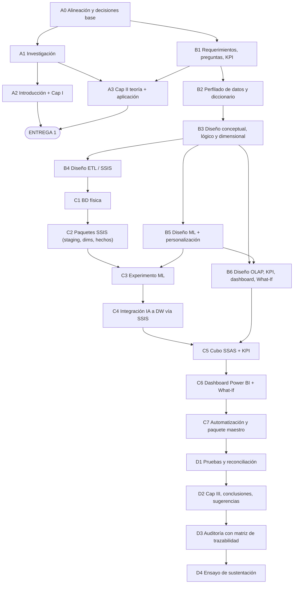

# 05. PLAN MAESTRO DE DESARROLLO DEL PROYECTO BI + IA
**Tema asignado por el docente:** *Sistema Inteligente de Evaluación Adaptativa y Personalización del Aprendizaje Universitario*
**Fuente principal:** `Proyecto_Final_GADI_IA_2026.docx` (secciones 1 a 13)
**Naturaleza de este documento:** es una guía de trabajo. No contiene texto para copiar al informe, código ni resultados. Cada punto indica **qué hacer, qué investigar, qué decidir, qué diseñar, cómo se conecta con el sistema, de qué depende y cómo verificarlo**.

> **Cómo usarlo.** Avanza por las fases (§3) en orden. Cada vez que una fase te mande a un apartado del informe, abre su ficha en §4. Antes de cerrar una fase, revisa sus "criterios de finalización" y marca las filas que correspondan en la matriz de trazabilidad (§6).

---

## 0. Hechos ya verificados (punto de partida)

Estos datos ya están comprobados con los archivos de la carpeta o con fuentes oficiales. Son la base sobre la que se toman las decisiones.

| Elemento | Hecho verificado | Implicación |
|---|---|---|
| Tema | El `.docx` dice textualmente "Sistema Inteligente de Evaluación Adaptativa y Personalización del Aprendizaje Universitario" | Los docs `README`/`03` usan otro título → hay que corregirlo |
| UCI `data.csv` | 4,424 filas × 37 columnas; 0 nulos; 0 duplicados. Target: Graduate 49.9 %, Dropout 32.1 %, Enrolled 17.9 %. Notas en escala 0–20; nota de admisión en escala 0–200. 718 registros con nota S1 = 0 (180 sin unidades matriculadas). 17 códigos de programa. Sin fechas. | Es el único dataset con resultado individual. Las clases están desbalanceadas, no hay eje temporal real y hay que tratar las notas en 0 |
| TUNI matrícula 2025-II | Agregado en `outputs/stg_matricula_tuni.csv`: 5,266 filas y 1,617,570 matrículas; un solo periodo (2025-2); gestión Público/Privado; viene con GUID por persona en origen | Sirve solo como contexto agregado. **Un solo periodo** → no permite evolución histórica |
| TUNI institucional | Clasifica los programas en grupos CINE (`PROGRAMA_CODIGO_GRUPO_1/3`); codificación Windows-1252 | Puede servir de puente conceptual por área de conocimiento con los programas UCI |
| ENAHO 2023 | Módulos 300 y 500 presentes. Se unen por CONGLOME+VIVIENDA+HOGAR+CODPERSO. `P308A=5` = superior universitaria (3,600 obs.); `P308D` = pública/privada; factor `FAC500A` | Cálculo **preliminar** ponderado: 44.0 % trabaja; 34.7 h/semana entre quienes trabajan. Hay que recalcularlo y documentarlo en tu ETL |
| UNFV | Creada por **Ley N.° 14692** del 30/10/1963 (el doc `03` dice 14693 → error). La FIEI tiene 4 escuelas: Electrónica, Informática, Mecatrónica y Telecomunicaciones | La misión y la visión tienen variantes en la web: cita el documento oficial vigente (Estatuto/PEI) con su fecha |
| Herramientas | SSIS en Visual Studio (visto en clase), SQL Server, SSAS, Power BI, Python | La pila tecnológica está cerrada |

---

## 1. Decisiones abiertas (ciérralas en el orden indicado)

| ID | Decisión | Alternativas | Recomendación y motivo | Cerrar en fase | Condiciona a |
|---|---|---|---|---|---|
| D1 | Título final | (a) Título exacto del docente; (b) título exacto + subtítulo de alcance; (c) "Alerta temprana…" | **(b)**: respeta el tema asignado y el subtítulo aclara el alcance (DataMart + SSIS + OLAP + ML) | A0 | Todo el informe |
| D2 | Significado operativo de "adaptativa" | (a) Examen adaptativo con banco de ítems (CAT); (b) re-evaluación del riesgo por etapas + intervención adaptada | **(b)**: es lo que permiten los datos. (a) va en limitaciones y sugerencias | A0 | Objetivos, TO-BE, Cap II, ML |
| D3 | Significado operativo de "personalización" | (a) Reglas por umbral; (b) segmentación en perfiles + matriz perfil × riesgo; (c) sistema recomendador colaborativo | **(b)**: es técnicamente justificable (Silhouette) y no requiere datos de interacción que no existen | A0 | Cap II, ML, dashboard |
| D4 | Organización del caso | (a) UNFV-FIEI como contexto organizacional y UCI como dataset de referencia; (b) una universidad genérica | **(a)**, declarando explícitamente que UCI es una prueba de concepto y no datos de la UNFV | A0 | Cap I completo |
| D5 | Fuente del AS-IS | (a) Entrevista a un tutor o director de escuela + reglamento de tutoría; (b) solo documentos normativos; (c) proceso supuesto | **(a)**; como mínimo (b). La opción (c) no es defendible | A1 | AS-IS, puntos de dolor |
| D6 | Nota aprobatoria peruana | 11 vs 10.5 redondeado | Verifica el **Reglamento Académico UNFV** vigente y usa lo que diga | A1 | ETL (flag aprobado), KPI |
| D7 | Formulación del target | (a) Multiclase de 3 clases; (b) binaria Dropout vs No-Dropout | **(a)** para entrenar, conservando "Enrolled". Decide y reporta además las métricas de la clase Dropout | B5 | ML, FactRiesgo, DimResultado |
| D8 | Momentos de predicción | Ingreso / Fin S1 / Fin S2 | **Ingreso + Fin S1**. S2 solo se usa como dato histórico en BI y nunca como entrada del ML (fuga de datos) | B5 | Grano de las tablas de hechos, ML |
| D9 | Algoritmos | LR + RF (mínimo); + HistGradientBoosting/XGBoost (opcional) | LR (línea base) + RF; el tercero solo si sobra tiempo | B5 | Capítulo II §ML, ML |
| D10 | Predicciones para toda la población | (a) Solo el conjunto de prueba; (b) probabilidades *out-of-fold* para todos | **(b)**: el dashboard necesita a los 4,424 alumnos. Las métricas oficiales se siguen reportando sobre el test | B5 | FactRiesgo, Power BI |
| D11 | Umbrales de riesgo | (a) Fijos 0.40/0.60; (b) derivados de la curva Precision-Recall y de la capacidad de tutoría | **(b)** para el valor por defecto, y además como parámetro What-If | B5/B6 | DimNivelRiesgo, What-If |
| D12 | Uso de ENAHO | (a) Solo cita en la Introducción; (b) tabla de hechos agregada de contexto laboral | **(b)** si el tiempo lo permite (bajo costo y refuerza el criterio 1). Se conecta con TUNI por departamento/gestión, **nunca con UCI** | B3 | DataMart, página de contexto |
| D13 | Puente UCI ↔ TUNI | (a) Ninguno; (b) mapeo de los 17 programas UCI a un área CINE | **(b)** documentado como homologación por área, sin unir alumnos | B3 | DimAreaConocimiento conformada |
| D14 | Eje temporal | (a) DimEtapa como eje; (b) inventar fechas; (c) descargar más periodos TUNI | **(a)** + **(c)** si hay periodos disponibles. **(b) está prohibido** | B3 | Requisito "evolución histórica" del dashboard |
| D15 | Modo de SSAS | Multidimensional (MDX) vs Tabular (DAX) | El modo **que se vio en clase**. Si no se definió, Multidimensional, porque la rúbrica habla de "cubos" | B6 | Diseño OLAP |
| D16 | Integración Python ↔ SQL | (a) Python escribe directo a SQL; (b) Python genera un archivo y SSIS lo carga; (c) SSIS invoca Python (Execute Process Task) y luego carga | **(c)**: SSIS queda como único orquestador y canal de carga, y la trazabilidad es completa | B4 | Paquetes SSIS, criterio 6 |
| D17 | Unión ENAHO 300+500 | (a) Merge Join en SSIS; (b) cargar ambos a staging y unir con T-SQL | **(b)**: Merge Join exige ordenar ~100k+ filas con cientos de columnas; en SQL es más simple y auditable | B4 | Paquete ENAHO |

---

## 2. Contradicciones, vacíos y riesgos

| # | Tipo | Descripción | Acción | Fase |
|---|---|---|---|---|
| R1 | Contradicción | Los docs `README`/`03` usan el título "Alerta Temprana…" | Aplicar D1 en todos los documentos | A0 |
| R2 | Error | En `03`, el número de ley de la UNFV es 14693; el correcto es 14692 | Corregir y citar la fuente | A2 |
| R3 | Dato no verificado | 45.4 % y 28.7 h (ENAHO) no coinciden con el cálculo preliminar (44.0 % y 34.7 h) | Recalcular con una definición escrita (universo, factor, variables de horas) | A1 |
| R4 | Dato inventado | El ejemplo "84.2 % de abandono con trabajo > 25 h" en `03` §3.4 | Eliminarlo y usar un ejemplo con variables reales de UCI | A0 |
| R5 | Modelo inválido | La FK `socio_key` (ENAHO) en la tabla de progreso UCI | Eliminarla y aplicar D12 | A0 |
| R6 | Generalización indebida | Presentar resultados UCI (Portugal) como si fueran de la UNFV | Declarar en Introducción, Alcance y Limitaciones | A2 |
| R7 | Vacío | No hay evidencia del proceso real de tutoría en la FIEI | D5: entrevista o reglamento | A1 |
| R8 | Vacío | El organigrama oficial de la UNFV/FIEI no está en la carpeta | Descargar el ROF/organigrama oficial; no reconstruirlo de memoria | A1 |
| R9 | Requisito difícil | El dashboard exige "evolución histórica", pero UCI no tiene fechas | D14 | B3 |
| R10 | Riesgo ético | Se recomiendan intervenciones cuya efectividad no está medida | En el What-If, la efectividad es un **supuesto de escenario**, no un resultado | B6 |
| R11 | Calidad de datos | Las notas = 0 sesgan el promedio | Regla de calidad: nota 0 con aprobadas = 0 → "sin nota" | B4 |
| R12 | Técnico | TUNI tiene 608 MB y ENAHO-500 tiene 260 MB con cientos de columnas; codificación 1252 | Code page 1252 en las conexiones; usar solo las columnas necesarias; agregación temprana | B4/C2 |
| R13 | Privacidad | El TUNI de origen tiene GUID por persona | No cargar el GUID al DW; supresión de celdas pequeñas (k ≥ 5) | B4 |
| R14 | Entorno | Versiones de SSIS/SSAS/VS y ediciones de SQL Server | Verificar la instalación de todos los integrantes antes de C1 | B4 |
| R15 | Alcance | Riesgo de sumar componentes (web, CAT, OULAD) | Congelar el alcance al cerrar A0 | A0 |

---

## 3. Hoja de ruta por fases

> **Clave de la secuencia:** B1 (preguntas y KPI) se hace **antes** de terminar el Cap II. Así cada concepto teórico puede justificarse con su uso real en el proyecto.

### A. Planificación académica

| Fase | Objetivo | Actividades concretas | Decisiones a cerrar | Entregables | Depende de | Criterio de finalización |
|---|---|---|---|---|---|---|
| **A0 Alineación** | Fijar el tema, el alcance y el vocabulario del proyecto | 1) Leer el `.docx` completo en equipo. 2) Cerrar D1–D4. 3) Redactar (para uso interno) una definición de una línea de "adaptativa" y otra de "personalización". 4) Lista de lo que el proyecto **no** hace. 5) Corregir R1, R4 y R5 en los docs existentes | D1, D2, D3, D4 | Ficha de alcance (1 página): título, objetivo general, 4–5 objetivos específicos, lo que entra y lo que no entra | — | Todo el equipo puede explicar en 30 s qué es "adaptativo" y qué es "personalizado" en este sistema |
| **A1 Investigación** | Reunir evidencia institucional, estadística y bibliográfica | 1) Estatuto/PEI/ROF de la UNFV (misión, visión, valores, organigrama). 2) Reglamento académico (nota aprobatoria, matrícula condicionada) y reglamento de tutoría. 3) Ley Universitaria 30220 (artículos sobre tutoría, bienestar y matrícula condicionada; **verifica el número exacto de cada artículo**). 4) Entrevista breve a un tutor o director (D5). 5) Recalcular las cifras ENAHO (R3). 6) Búsqueda bibliográfica (ver tabla de búsqueda en §4.3) | D5, D6 | Carpeta de evidencias con PDFs y enlaces; guía de entrevista y notas; tabla de cifras ENAHO con su definición; matriz bibliográfica (autor, año, aporte, apartado donde se usa, idioma) | A0 | ≥ 20 referencias, con 15–20 % en inglés y al menos 5 antecedentes empíricos sobre predicción de deserción o aprendizaje adaptativo |
| **A2 Intro + Cap I** | Sustentar el problema y el contexto | Seguir las fichas §4.1 y §4.2 | — | Borrador de la Introducción y del Cap I; diagramas AS-IS, TO-BE y organigrama | A1 | Cada afirmación cuantitativa tiene una fuente; el AS-IS se apoya en evidencia |
| **A3 Cap II** | Teoría + aplicación al proyecto | Seguir la ficha §4.3. Cada subtema tiene dos bloques: concepto (citado) y "aplicación en el proyecto" | Las decisiones de diseño que se anuncian en Cap II (D7–D16) deben estar al menos **preseleccionadas** | Borrador del Cap II con tablas de aplicación | A1, B1 | Cada subtema termina con una decisión de diseño o un artefacto del Cap III al que se vincula |

### B. Diseño de la solución (antes de implementar)

| Fase | Objetivo | Actividades concretas | Decisiones | Entregables | Depende de | Criterio de finalización |
|---|---|---|---|---|---|---|
| **B1 Requerimientos** | Convertir el problema en necesidades de información | 1) Identificar actores (director de escuela, comité de tutoría, bienestar, docente tutor). 2) Escribir historias de necesidad: "como X necesito Y para decidir Z". 3) Derivar 6–10 preguntas de negocio. 4) Derivar KPI con fórmula, meta y fuente. 5) Definir las perspectivas de análisis (dimensiones candidatas) | Qué decisiones concretas apoya el sistema | Matriz actor–decisión–pregunta–KPI–dimensión | A0 | Cada pregunta tiene al menos un KPI y una dimensión; cada KPI se puede calcular con columnas que existen |
| **B2 Perfilado** | Conocer los datos reales | 1) Diccionario de datos de UCI (37 columnas: tipo, dominio, rol: ID/entrada M1/entrada M2/fuera del ML/target). 2) Diccionario de las columnas usadas de TUNI y ENAHO. 3) Perfil de calidad: nulos, rangos, códigos, outliers, codificación. 4) Clasificar las variables por momento de disponibilidad | Qué columnas entran a M1 y cuáles a M2 | Diccionario de datos; reporte de calidad; tabla "variable × momento" | B1 | Ninguna variable del 2do semestre ni el target aparece como entrada de M1 o M2 |
| **B3 Diseño dimensional** | Diseñar el DataMart | Ver §5.1 (pasos 1–9) | D12, D13, D14 | Modelo conceptual, conceptual ampliado, lógico, matriz bus, diagrama dimensional, tabla de granularidad | B2 | Cada pregunta de B1 se responde con una consulta sobre el modelo (prueba en papel) |
| **B4 Diseño ETL** | Diseñar el flujo SSIS | Ver §5.2 | D16, D17, D6 | Documento fuente-destino, catálogo de reglas de calidad, diseño de paquetes, diseño de log/auditoría | B3 | Cada columna destino tiene su origen y su transformación documentados |
| **B5 Diseño ML** | Especificar el experimento | Ver §5.4 y §5.5 | D7–D11 | Protocolo experimental, matriz de recomendación (borrador), contrato de salida (columnas que el ML entrega al DW) | B2, B3 | El protocolo es reproducible por otro integrante sin preguntar nada |
| **B6 Diseño OLAP/BI** | Diseñar el cubo, los KPI, el dashboard y el What-If | Ver §5.3, §5.6 y §5.7 | D11, D15 | Diseño del cubo, catálogo de medidas/KPI, mockups (bocetos) de las páginas de Power BI, especificación del What-If | B3, B5 | Cada elemento obligatorio del dashboard (§8 del docx) aparece en algún mockup |

### C. Implementación técnica (secuencia)

| Fase | Objetivo | Actividades | Entregables / evidencia | Depende de | Criterio de finalización |
|---|---|---|---|---|---|
| **C1 BD física** | Crear la base, los esquemas `stg`/`dw`/`audit` y las tablas | Implementar el modelo lógico con PK, FK, CHECK y miembro "Desconocido" en las dimensiones | Scripts DDL; diagrama de la base en SSMS | B3 | El diagrama de SSMS coincide con el diseño de B3 |
| **C2 SSIS** | Cargar staging, dimensiones y hechos | Construir los paquetes en el orden de §5.2 | Proyecto SSIS; capturas de Control Flow y Data Flow con conteo de filas; tabla de auditoría con datos | C1, B4 | Conciliación: filas de origen = cargadas + rechazadas, en cada paquete |
| **C3 ML** | Ejecutar el experimento | Notebook que lee del DW; M1 y M2 × LR/RF; métricas; K-Means; matriz de recomendación; archivo de salida según el contrato | Notebook; tabla comparativa; matrices de confusión; curva Silhouette; importancia de variables | C2, B5 | Las métricas son reproducibles con semilla fija |
| **C4 Integración IA** | Llevar los resultados del ML al DW | Paquete SSIS que ejecuta Python (D16) y carga la tabla de hechos de riesgo | Tabla de hechos de riesgo poblada; registro de auditoría | C3 | Hay 1 fila por estudiante × etapa × modelo y las probabilidades suman 1 |
| **C5 SSAS** | Construir el cubo y los KPI | DSV, dimensiones, jerarquías, medidas, KPI, procesamiento | Proyecto SSAS; capturas del Browser; consultas MDX | C4, B6 | Las 4 operaciones OLAP quedan demostradas con capturas |
| **C6 Power BI** | Dashboard + What-If | Conexión (al cubo o al DW), páginas según los mockups, parámetros What-If | Archivo `.pbix`; capturas | C5 | Todos los elementos de §8 del docx están presentes |
| **C7 Automatización** | Ejecutar todo de punta a punta | Paquete maestro + SQL Agent Job (o ejecución programada) | Captura del job; historial de ejecución | C2–C6 | Una sola ejecución recarga todo sin intervención manual |

### D. Validación y sustentación

| Fase | Objetivo | Actividades | Entregables | Criterio de finalización |
|---|---|---|---|---|
| **D1 Pruebas** | Comprobar la trazabilidad y la exactitud | 1) Conciliar conteos CSV → staging → DW → cubo → Power BI. 2) Recalcular 3 KPI a mano (SQL) y compararlos con el dashboard. 3) Verificar que no haya fuga de datos en el ML. 4) Probar el What-If con valores extremos | Matriz de pruebas con resultados | 100 % de los casos de prueba pasan o están justificados |
| **D2 Cap III y cierre** | Documentar la solución y las conclusiones | Seguir las fichas §4.4 y §4.5 | Cap III, conclusiones, sugerencias y referencias | Cada conclusión cita una evidencia del sistema |
| **D3 Auditoría** | Comprobar contra la rúbrica | Recorrer la matriz §6 fila por fila | Matriz completa con evidencias enlazadas | Ninguna fila sin evidencia |
| **D4 Defensa** | Preparar la sustentación | Guion de demo; banco de preguntas difíciles; ensayo del reto imprevisto | Guion, diapositivas, demo ensayada | Cada integrante puede operar la demo y responder sobre cualquier componente |

---

## 4. Guía por apartado del informe

> Formato de cada ficha: **Poner** (qué contenido) · **Investigar** · **Decidir** · **Diseñar** · **Aplicación** (relación con el sistema) · **Requiere** (dependencias) · **Verificar**.

### 4.1 Introducción

**1. Presentación del proyecto**
- **Poner:** qué se construye (componentes de la arquitectura del docente), para quién (actores de B1) y qué decisión apoya.
- **Investigar:** la arquitectura del `.docx` §3; nada externo.
- **Decidir:** D1 (título) y D2/D3 (vocabulario).
- **Diseñar:** diagrama de arquitectura de alto nivel (7 bloques del docente, con las herramientas en cada bloque).
- **Aplicación:** es el "mapa" que se repite en el Cap III; usa los mismos nombres de componentes.
- **Requiere:** A0.
- **Verificar:** un lector entiende en un párrafo qué hace el sistema; aparecen las palabras "adaptativa" y "personalización" con su significado operativo.

**2. Problema identificado**
- **Poner:** el síntoma (deserción y rendimiento bajo en primeros ciclos), la causa de gestión (seguimiento tardío, intervención uniforme) y la consecuencia. Incluye la cuantificación con fuentes peruanas y la del dataset de referencia.
- **Investigar:** cifras de deserción universitaria en el Perú (SUNEDU/MINEDU/INEI, con año); las cifras ENAHO recalculadas (R3); la tasa de abandono del dataset UCI como referencia, indicando que no es peruana.
- **Decidir:** qué 2–3 cifras usar; descarta las que no tengan fuente primaria.
- **Diseñar:** árbol de problemas (causa → problema → efecto).
- **Aplicación:** cada causa del árbol debe tener una respuesta en el TO-BE y en un componente (p. ej. "intervención uniforme" → matriz de personalización).
- **Requiere:** A1.
- **Verificar:** 0 cifras sin cita; el problema es de **gestión/decisión**, no solo "hay deserción".

**3. Importancia de la solución**
- **Poner:** beneficios por actor (tutoría, dirección, bienestar, estudiante); valor de anticipar y de personalizar.
- **Investigar:** 2–3 antecedentes que reporten utilidad de sistemas de alerta o personalización (de la matriz bibliográfica).
- **Decidir:** qué beneficios prometer. Solo los que el sistema realmente entrega (no "reduce la deserción X %").
- **Diseñar:** tabla actor → beneficio → componente que lo produce.
- **Aplicación:** alimenta los objetivos específicos y las conclusiones.
- **Requiere:** B1 (actores).
- **Verificar:** no hay beneficios que dependan de una intervención real no evaluada (R10).

**4. Alcance general (y limitaciones)**
- **Poner:** lo que incluye (fuentes, componentes, momentos de predicción, tipo de recomendación) y lo que excluye (CAT, web, datos reales de la UNFV, medición de impacto). Agrega objetivo general y objetivos específicos si el docente lo permite en esta sección.
- **Investigar:** licencias de los datasets (UCI CC BY 4.0, términos de TUNI/ENAHO).
- **Decidir:** D2, D4, D8, D14 y R6.
- **Diseñar:** tabla "Incluye / No incluye / Motivo".
- **Aplicación:** es la defensa anticipada contra preguntas del jurado.
- **Requiere:** A0.
- **Verificar:** cada límite declarado coincide con lo que realmente se implementa.

### 4.2 Capítulo I: Generalidades

**1.1 Descripción de la organización**
- **Poner:** UNFV, tipo (pública, licenciada: verifica el estado y la resolución SUNEDU), FIEI y sus 4 escuelas, ámbito del piloto.
- **Investigar:** portal UNFV, resolución de licenciamiento, página FIEI; datos de matrícula de la UNFV en tu propio TUNI agregado (sí puedes usarlos; es dato oficial).
- **Decidir:** si el piloto es toda la FIEI o una escuela. Recomendado: FIEI.
- **Diseñar:** ficha institucional (tabla).
- **Aplicación:** la UNFV aparece como fila de `DimInstitucion` en el contexto TUNI; esto conecta el Cap I con el dashboard de contexto.
- **Requiere:** A1.
- **Verificar:** cada dato institucional tiene fuente oficial.

**1.2 Historia, misión, visión, valores**
- **Poner:** reseña breve (Ley 14692), misión, visión y valores **textuales**.
- **Investigar:** el Estatuto o PEI vigente (hay variantes en la web; usa el documento oficial más reciente).
- **Decidir:** qué versión citar.
- **Diseñar:** tabla de alineamiento: misión/visión → objetivo del proyecto.
- **Aplicación:** justifica que los KPI (permanencia, rendimiento) están alineados con la estrategia institucional (criterio "KPI relacionados con objetivos").
- **Requiere:** A1.
- **Verificar:** citas textuales con fuente; la tabla de alineamiento existe.

**1.3 Organización y organigrama**
- **Poner:** organigrama oficial (general) + vista focalizada de las unidades que participan en el proceso.
- **Investigar:** ROF/MOF y organigrama oficial UNFV/FIEI (R8).
- **Decidir:** nivel de detalle (recomendado: Rectorado → Vicerrectorado Académico → Facultad → Escuelas / Tutoría / Bienestar).
- **Diseñar:** organigrama redibujado con la fuente citada.
- **Aplicación:** las unidades del organigrama son los actores de B1 y los consumidores del dashboard.
- **Requiere:** A1.
- **Verificar:** ninguna unidad inventada; las unidades coinciden con los carriles (*swimlanes*) del AS-IS.

**1.4 Área involucrada**
- **Poner:** unidades responsables, sus funciones normativas y qué decisiones toman.
- **Investigar:** reglamento de tutoría, funciones de bienestar, artículos de la Ley 30220 sobre tutoría y bienestar.
- **Decidir:** el "dueño" del sistema (recomendado: Dirección de Escuela + Comité de Tutoría).
- **Diseñar:** matriz RACI (responsable, aprobador, consultado, informado) del proceso de seguimiento.
- **Aplicación:** define quién usa cada página del dashboard y quién valida las recomendaciones.
- **Requiere:** 1.3.
- **Verificar:** cada actor de B1 aparece en la RACI.

**1.5 Descripción del proceso actual**
- **Poner:** pasos, actores, documentos, sistemas, tiempos y puntos de decisión del seguimiento académico actual.
- **Investigar:** entrevista y reglamentos (D5); calendario académico (semanas de parciales y finales).
- **Decidir:** el proceso de negocio exacto. Recomendado: "seguimiento académico y tutoría del estudiante de primeros ciclos".
- **Diseñar:** tabla de pasos (n.º, actividad, actor, insumo, salida, tiempo, problema).
- **Aplicación:** es el proceso de negocio del DataMart (Kimball): el grano y los hechos salen de aquí.
- **Requiere:** 1.4.
- **Verificar:** cada problema listado se puede rastrear a una evidencia (entrevista o documento).

**1.6 Diagrama AS-IS**
- **Poner:** diagrama BPMN o flujo con carriles por actor y anotaciones de dolor (latencia, falta de información, intervención uniforme).
- **Investigar:** notación BPMN básica.
- **Decidir:** herramienta (Bizagi o draw.io) y notación.
- **Diseñar:** diagrama AS-IS con puntos de dolor numerados.
- **Aplicación:** cada punto de dolor numerado debe tener su solución numerada en el TO-BE.
- **Requiere:** 1.5.
- **Verificar:** coherencia total con la tabla de 1.5.

**1.7 Propuesta TO-BE**
- **Poner:** el mismo proceso con el sistema incorporado: carga ETL, evaluación al ingreso (M1), re-evaluación en S1 (M2), asignación de perfil, recomendación personalizada, validación por el tutor y retroalimentación.
- **Investigar:** —
- **Decidir:** en qué momento del semestre se emite cada evaluación (alineado con D8) y quién valida la recomendación.
- **Diseñar:** diagrama TO-BE + tabla de comparación AS-IS vs TO-BE (dolor → mejora → componente → KPI que lo mide).
- **Aplicación:** es el contrato funcional del Cap III; todo lo que aparece aquí debe implementarse.
- **Requiere:** 1.6, D2, D3, D8.
- **Verificar:** no aparece ningún paso que el sistema no vaya a implementar (p. ej. captura de datos socioeconómicos individuales que no tienen).

### 4.3 Capítulo II: Marco teórico (concepto + aplicación)

**Regla para todo el capítulo:** cada subtema tiene (1) concepto con 2+ citas y (2) un bloque **"Aplicación en el proyecto"** en forma de tabla o lista que nombre el artefacto concreto del Cap III. En el Cap II se anuncian **enfoques y criterios**, no resultados.

**Plan de búsqueda bibliográfica (A1)**
| Subtema | Qué buscar | Términos sugeridos | Tipo de fuente |
|---|---|---|---|
| Antecedentes | Estudios de predicción de deserción con ML; estudios peruanos | `student dropout prediction machine learning higher education`; `deserción universitaria Perú machine learning` | Artículos indexados, tesis UNFV/UNI/PUCP (repositorios) |
| Evaluación adaptativa / personalización | Revisiones de aprendizaje adaptativo; analítica del aprendizaje | `personalized adaptive learning higher education review`; `learning analytics early warning` | Revisiones sistemáticas |
| BI / DW / OLAP | Obras clásicas | Kimball & Ross; Inmon; Chaudhuri & Dayal | Libros y artículos clásicos |
| KPI | Teoría de indicadores | Parmenter; Kaplan & Norton | Libros |
| ML | Algoritmos y métricas | Breiman (RF); Hosmer (LR); Rousseeuw (Silhouette); Saito & Rehmsmeier (PR) | Artículos originales |
| Dataset | Artículo del dataset | Realinho et al. (artículo en la revista *Data*, 2022) | Artículo del dataset |

**2.0 Antecedentes (recomendado aunque no esté en la lista del docente: "investigaciones confiables")**
- **Poner:** 5–8 antecedentes (internacionales y nacionales) en una tabla: autor, contexto, datos, técnica, métricas, aporte a tu proyecto.
- **Decidir:** qué técnicas y métricas tomas de ellos.
- **Aplicación:** justifica D7–D11 con precedentes.
- **Verificar:** cada antecedente tiene una columna "qué adopto de este estudio".

**2.1 Inteligencia de negocios**
- **Poner:** definición, componentes y ciclo de BI.
- **Aplicación:** tabla "componente BI → herramienta → artefacto del proyecto" (SQL Server, SSIS, SSAS, Power BI).
- **Verificar:** la tabla coincide con el diagrama de arquitectura de la Introducción.

**2.2 Data Warehouse y DataMart**
- **Poner:** Inmon vs Kimball; DW vs DataMart; área de staging.
- **Decidir:** enfoque (Kimball, bottom-up) y por qué un DataMart departamental.
- **Aplicación:** nombra el proceso de negocio (de 1.5), los esquemas `stg`/`dw` y las tablas de hechos previstas.
- **Verificar:** la decisión está argumentada con el alcance (no "porque es mejor").

**2.3 Modelos dimensionales**
- **Poner:** estrella, copo de nieve, constelación.
- **Decidir:** con varias tablas de hechos que comparten dimensiones, el modelo es una **constelación**. Nómbralo así o justifica por qué lo llamas estrella.
- **Aplicación:** boceto preliminar de la matriz bus (procesos × dimensiones), que en el Cap III se vuelve el modelo final.
- **Verificar:** el término coincide con el diagrama del Cap III.

**2.4 Datos, información y conocimiento**
- **Poner:** pirámide DIKW.
- **Aplicación:** tabla de 4 filas con **variables reales** del proyecto. Ejemplo de estructura: dato (columna UCI) → información (KPI en el DW) → conocimiento (patrón del modelo o perfil) → decisión (acción de la matriz). No pongas cifras de resultados que aún no tienes.
- **Verificar:** sin cifras inventadas (R4).

**2.5 Dimensiones, medidas, jerarquías y granularidad**
- **Poner:** definiciones; medidas aditivas, semiaditivas y no aditivas; jerarquías; grano.
- **Aplicación:** tabla preliminar: hecho → grano → medidas (con su tipo de aditividad) → dimensiones → jerarquías. Ejemplo: tasa de aprobación = no aditiva → se calcula como cociente de sumas.
- **Requiere:** B1, borrador de B3.
- **Verificar:** cada medida tiene declarada su aditividad.

**2.6 Cubos OLAP**
- **Poner:** cubo, MOLAP/ROLAP, operaciones (roll-up, drill-down, slice, dice, pivot), MDX.
- **Decidir:** D15.
- **Aplicación:** tabla "operación OLAP → pregunta de negocio del proyecto que resuelve → jerarquía usada".
- **Verificar:** las 5 operaciones están vinculadas a preguntas de B1.

**2.7 Indicadores de gestión y KPI**
- **Poner:** indicador vs KPI; atributos (fórmula, meta, frecuencia, responsable, semáforo).
- **Aplicación:** ficha de cada KPI del proyecto (de B1), con la meta marcada como "propuesta" si no hay meta institucional.
- **Verificar:** cada KPI está alineado con la misión/visión (tabla de 1.2) y con una pregunta de B1.

**2.8 Machine Learning e IA**
- **Poner:** aprendizaje supervisado y no supervisado; clasificación; LR, RF, K-Means; validación (train/test, validación cruzada); métricas (matriz de confusión, Precision, Recall, F1, Balanced Accuracy, ROC/PR-AUC, Silhouette); desbalance de clases; fuga de datos.
- **Decidir:** preseleccionar D7–D11.
- **Aplicación:** tabla "decisión de ML → justificación teórica → cómo se implementará". Ejemplo: Recall de Dropout como métrica prioritaria porque el costo de un falso negativo es alto.
- **Verificar:** se explica por qué la Accuracy sola no basta con estas proporciones de clase.

**2.9 Evaluación adaptativa, analítica del aprendizaje y personalización (recomendado: es el núcleo del tema)**
- **Poner:** evaluación adaptativa (incluido el CAT, para diferenciarlo), analítica del aprendizaje, sistemas de alerta temprana, personalización del aprendizaje y riesgos éticos (sesgo, etiquetado, privacidad).
- **Decidir:** declarar formalmente la definición operativa (D2, D3).
- **Aplicación:** diagrama del "ciclo adaptativo" del sistema: evaluar → predecir → segmentar → recomendar → validar → re-evaluar.
- **Verificar:** el jurado puede ver dónde está lo "adaptativo" y lo "personalizado" sin leer el Cap III.

**2.10 ETL e integración de datos (recomendado: criterio 3 de la rúbrica)**
- **Poner:** ETL vs ELT, staging, calidad de datos, SCD, auditoría; SSIS (Control Flow, Data Flow).
- **Aplicación:** tabla "fuente → problema de calidad conocido → regla de transformación prevista" (codificación 1252, notas = 0, escala 0–200, GUID, k ≥ 5).
- **Verificar:** cada regla aparece luego en el catálogo de reglas de B4.

### 4.4 Capítulo III: Desarrollo de la solución

| Apartado (docx) | Poner | Diseñar / evidencia | Requiere | Verificar |
|---|---|---|---|---|
| Análisis de requerimientos | Actores, necesidades, requisitos funcionales y no funcionales (privacidad, actualización, rendimiento) | Matriz actor–necesidad (B1) | B1 | Cada requisito tiene un componente que lo cumple |
| Preguntas de negocio | 6–10 preguntas priorizadas | Tabla pregunta → KPI → dimensiones → página del dashboard | B1 | Todas se responden en el dashboard (D1) |
| Indicadores y perspectivas | KPI con ficha; perspectivas = dimensiones | Fichas KPI; matriz KPI × dimensión | B1 | Fórmulas calculables con columnas existentes |
| Modelo conceptual | Entidades del negocio y relaciones (independiente de la tecnología) | Diagrama conceptual | B2 | Sin nombres de tablas físicas |
| Análisis de la base OLTP | `data.csv` como extracto transaccional; TUNI y ENAHO como fuentes externas; diccionario, calidad, volúmenes | Diccionario + reporte de calidad (B2) | B2 | Declara las limitaciones (sin fechas, sin ID real, agregación) |
| Relaciones identificadas | Qué fuentes se relacionan, por qué clave y cuáles **no** se relacionan y por qué | Tabla de relaciones válidas y no válidas | B2, D12, D13 | Incluye explícitamente "UCI ↔ ENAHO: sin relación" |
| Nivel de granularidad | Grano declarado por tabla de hechos | Tabla de granularidad (§5.1 paso 3) | B3 | El grano está escrito en una frase y no es ambiguo |
| Modelo conceptual ampliado | El conceptual + hechos, medidas y dimensiones | Diagrama ampliado | B3 | Coincide con la matriz bus |
| Modelo lógico del DataMart | Tablas, claves, tipos, FK | Diagrama lógico | B3 | Cada FK apunta a una dimensión existente |
| Tablas de dimensiones | Atributos, jerarquías, tipo SCD, miembro desconocido | Ficha por dimensión | B3 | Cada jerarquía se usa en el cubo |
| Tabla(s) de hechos | Medidas, aditividad, FK, grano | Ficha por tabla de hechos | B3 | Las medidas no aditivas se calculan como cocientes |
| Modelo dimensional | Diagrama final (constelación) | Captura de SSMS + diagrama limpio | C1 | Es igual a lo implementado |
| Proceso ETL | Arquitectura, paquetes, flujo, reglas | Diagrama de paquetes; capturas de Control/Data Flow | B4, C2 | Cumple el criterio de conciliación |
| Carga y actualización | Carga inicial vs recarga; orden; job; auditoría | Captura del job y de la tabla de auditoría | C7 | Se demuestra una re-ejecución completa |
| Implementación de OLAP | Cubo, dimensiones, jerarquías, medidas, procesamiento | Capturas SSAS + consultas MDX | C5 | Las 4–5 operaciones OLAP están demostradas |
| Campos calculados y KPI | Medidas calculadas y KPI con meta y semáforo | Catálogo de medidas | C5/C6 | Los valores coinciden con la verificación SQL (D1) |
| Dashboards y reportes | Páginas, propósito, usuario y visuales | Capturas + tabla página → usuario → preguntas | C6 | Los 8 elementos de §8 del docx están presentes |
| Módulo de ML | Los 11 puntos del docx §4.2, en orden | Notebook + tablas + gráficos | C3 | Están los 11 puntos y hay comparación por métricas |
| Integración BI + IA | Flujo Python → SSIS → DW → cubo → dashboard | Diagrama + capturas de las tablas y visuales con predicciones | C4–C6 | Las predicciones están **almacenadas** y **visualizadas** |
| Resultados y recomendaciones | Hallazgos descriptivos + predictivos + matriz de acciones + What-If | Tablas de hallazgos con su evidencia | C6, D1 | Cada recomendación cita un dato del sistema |

### 4.5 Conclusiones, sugerencias y referencias

| Sección | Qué poner | Cómo construirla | Verificar |
|---|---|---|---|
| Conclusiones | Una conclusión por objetivo específico (+1 general) | Para cada objetivo: qué se hizo → evidencia (métrica, KPI, artefacto) → qué significa | 1:1 con los objetivos; sin afirmaciones sin evidencia |
| Sugerencias | Mejoras futuras | Toma la lista de "no incluye" del alcance: CAT con banco de ítems, datos reales de la UNFV anonimizados, evaluación de impacto de las intervenciones, más periodos TUNI | Cada sugerencia ataca una limitación declarada |
| Referencias | APA 7, 15–20 % en inglés | Usa la matriz bibliográfica de A1; cita el dataset UCI con DOI y la licencia | Todas las citas del texto están en la lista y viceversa |

---

## 5. Diseño técnico secuenciado

### 5.1 DataMart: pasos de diseño en orden (Kimball, 4 pasos + extensiones)

| Paso | Acción | Decisión que condiciona | Entregable |
|---|---|---|---|
| 1 | Elegir los procesos de negocio | Recomendado: (P1) evaluación del progreso académico; (P2) evaluación de riesgo y recomendación; (P3) contexto de matrícula nacional; (P4, opcional) contexto laboral estudiantil | Lista de procesos |
| 2 | Construir la **matriz bus** (procesos × dimensiones) | Identifica las dimensiones conformadas (p. ej. Área de conocimiento entre P1/P2 y P3; Geografía y Gestión entre P3 y P4) | Matriz bus |
| 3 | Declarar el **grano** de cada tabla de hechos | P1: estudiante × etapa. P2: estudiante × etapa de predicción × modelo. P3: institución × programa × local × periodo. P4: departamento × gestión × tramo de horas (agregado y ponderado) | Tabla de granularidad |
| 4 | Identificar las dimensiones y sus atributos | Perfil del estudiante (anónimo), Programa, Área CINE, Etapa, Resultado, Modelo, Nivel de riesgo, Perfil de aprendizaje, Recomendación, Contexto macro, Institución, Programa TUNI, Geografía, Periodo, Tramo de horas | Ficha por dimensión |
| 5 | Identificar las medidas y su aditividad | Unidades curriculares (aditivas), nota (no aditiva → promedio), probabilidades (no aditivas), matrícula (aditiva), población ponderada (aditiva) | Ficha por tabla de hechos |
| 6 | Definir las jerarquías | Área → Programa; Gestión → Institución; Departamento → Provincia → Distrito; Nivel de riesgo → Perfil | Tabla de jerarquías |
| 7 | Definir claves sustitutas, miembro desconocido y SCD | Recomendado: SCD tipo 1 (carga histórica estática) | Convenciones de nombres y claves |
| 8 | Prueba en papel | Escribir, para cada pregunta de B1, qué hecho + dimensiones la responden | Tabla pregunta → consulta |
| 9 | Diseño lógico y físico | Tipos de datos, CHECK (nota 0–20, probabilidades 0–1), índices | Diagrama lógico |

### 5.2 Diseño preliminar de paquetes SSIS (sin código)

**Orden de diseño:** 1) documento fuente-destino → 2) catálogo de reglas de calidad → 3) diseño de auditoría → 4) paquetes.

**Parámetros del proyecto que hay que definir:** ruta de las carpetas de origen, cadena de conexión, carpeta de salida de Python, ruta del ejecutable de Python e ID de ejecución.

| Paquete | Propósito | Control Flow (tareas) | Data Flow (componentes) | Validaciones / calidad | Salida y evidencia |
|---|---|---|---|---|---|
| `PKG_00_Maestro` | Orquestar y auditar | Registrar el inicio de la ejecución → Execute Package (01…09) en orden → registrar el fin; manejador de eventos OnError | — | Si falla un paquete, se detiene la cadena | Tabla `audit.Ejecucion` |
| `PKG_01_STG_UCI` | Cargar `data.csv` a staging | Truncar staging → Data Flow → registrar conteos | Flat File (`;`, code page definida) → Data Conversion → Derived Column (escala 0–200→0–20, flag sin nota, tasa de aprobación, flag aprobado según D6) → Conditional Split (válidos/rechazados) → OLE DB Destination | Rangos, dominios de códigos, target ∈ {3 clases} | `stg` de UCI + tabla de rechazos |
| `PKG_02_STG_TUNI` | Agregar la matrícula | Truncar → Data Flow → registrar | Flat File (`\|`, 1252) → seleccionar solo las columnas necesarias (sin GUID) → Aggregate (conteo por grano P3) → Conditional Split (k ≥ 5) → destino; Lookup al catálogo institucional | Supresión de celdas pequeñas, coincidencia con el catálogo | `stg` TUNI agregado |
| `PKG_03_STG_ENAHO` | Preparar el contexto laboral | Data Flow módulo 300 → Data Flow módulo 500 → Execute SQL (unión por claves de persona, filtro de universitarios, tramo de horas, suma de pesos) | Flat File (solo las columnas necesarias) → destinos de staging | Unión 100 % de los universitarios; pesos > 0 | `stg` ENAHO agregado |
| `PKG_04_DIM` | Poblar las dimensiones | Data Flows por dimensión (estáticas primero: Etapa, Resultado, Nivel de riesgo, Recomendación) | Origen staging → Lookup (no coincide = nuevo) → destino; miembro desconocido | Unicidad de la clave natural | Dimensiones pobladas |
| `PKG_05_FACT_EVAL` | Hecho de progreso | Data Flow | Staging (despivotado a etapas) → Lookups a las dimensiones → destino | Huérfanos → desconocido + conteo | Hecho P1 |
| `PKG_06_ML` | Ejecutar el modelo | Execute Process Task (Python) → File System Task (verificar que el archivo existe) | — | Código de salida = 0; archivo con columnas según el contrato | Archivo de predicciones |
| `PKG_07_FACT_RIESGO` | Cargar los resultados de IA | Truncar → Data Flow | Flat File → Lookups (etapa, modelo, resultado, nivel, perfil, recomendación) → destino | Probabilidades en [0,1] y suma ≈ 1; 1 fila por grano | Hecho P2 |
| `PKG_08_FACT_CONTEXTO` | Hechos TUNI y ENAHO | Data Flows | Staging → Lookups → destino | Totales conciliados con staging | Hechos P3/P4 |
| `PKG_09_SSAS` | Procesar el cubo | Analysis Services Processing Task | — | Procesamiento sin errores | Cubo actualizado |

> En el primer diseño, `PKG_06_ML` lee del DW (después de `PKG_05`). Así la trazabilidad queda completa: CSV → DW → ML → DW.

### 5.3 OLAP, KPI y consultas (orden)
1. Elegir el modo de SSAS (D15).
2. Definir el DSV con las tablas de hechos y las dimensiones del DW.
3. Definir los grupos de medidas por tabla de hechos.
4. Definir las jerarquías (de §5.1 paso 6).
5. Definir los KPI SSAS: valor, meta, estado y tendencia (si no hay serie temporal, la tendencia se omite y se justifica).
6. Diseñar 5–6 consultas MDX, una por operación OLAP y pregunta de negocio.
7. Diseñar las capturas de evidencia.

### 5.4 Módulo de ML (orden de especificación del protocolo)
| Orden | Elemento a especificar | Qué decidir |
|---|---|---|
| 1 | Problema y unidad de predicción | D7; unidad = estudiante en una etapa |
| 2 | Variables por momento | Lista M1 y lista M2 (de B2); exclusiones (S2, target, columnas que solo se conocen después) |
| 3 | Preparación | Codificación de categóricas (los códigos numéricos de UCI son nominales), escalado (solo LR), tratamiento de notas = 0 |
| 4 | Partición | Estratificada 80/20 con semilla fija + validación cruzada estratificada de 5 folds para hiperparámetros |
| 5 | Algoritmos y espacio de hiperparámetros | D9; balanceo de clases |
| 6 | Métricas y criterio de selección | Métrica primaria (Recall de Dropout), restricción (F1-macro mínimo) y desempate. **Escribe el criterio antes de ver los resultados** |
| 7 | Umbral | D11: curva PR + capacidad de tutoría |
| 8 | Interpretación | Importancia por permutación; coeficientes de LR; análisis de errores (falsos negativos) |
| 9 | Predicción para toda la población | D10 |
| 10 | Contrato de salida | Columnas: id del estudiante, etapa, modelo, probabilidades por clase, clase predicha, nivel de riesgo, perfil, código de recomendación, indicador de pertenencia al test |

### 5.5 Mecanismo de personalización (orden)
1. Elegir las variables de perfil (comportamiento académico en S1 + condición financiera); justificar cada una.
2. Elegir k con Silhouette + método del codo; documentar el rango probado.
3. Describir los clusters con medias por variable y **nombrarlos después de verlos**, no antes.
4. Construir la matriz perfil × nivel de riesgo → acción, responsable y horas de tutor estimadas.
5. Validar la matriz con un tutor (de la entrevista D5) o con la literatura, y citarlo.
6. Definir que toda recomendación es una propuesta que valida el tutor (humano en el ciclo).

**Entregable:** la matriz se convierte en el contenido de la dimensión de recomendación.

### 5.6 Dashboard Power BI (orden)
1. Usuarios y preguntas por página (de B1).
2. Mockup en papel de cada página.
3. Comprobar los 8 elementos del docx §8: indicadores generales, evolución (eje Etapa y periodos TUNI si los hay), filtros, KPI, predicciones de IA, alertas, recomendaciones y apoyo a una decisión.
4. Decidir la fuente de datos: conexión en vivo al cubo vs importar desde el DW. Recomendado: cubo, porque demuestra la integración OLAP.
5. Diseñar la navegación entre páginas.

### 5.7 What-If (orden)
1. Elegir la decisión que se simula. Recomendado: "¿a cuántos alumnos intervenir y con qué recursos?".
2. Definir los parámetros: umbral de riesgo, horas de tutor disponibles, horas por tipo de intervención (de la matriz), efectividad supuesta (**etiquetada como supuesto**).
3. Definir las salidas: alumnos a intervenir, horas requeridas vs disponibles (brecha) y abandonos potencialmente evitables (escenario).
4. Preparar 3 escenarios guion (base, crisis +15 % de riesgo, recorte de recursos) para la defensa.

**Verificar:** con el umbral en el máximo, el número de alumnos a intervenir es mínimo, y el comportamiento es monótono.

---

## 6. Matriz de trazabilidad (requisitos del docente → evidencia)

| # | Requisito (fuente en el docx) | Apartado del informe | Actividad | Evidencia / entregable | Criterio de cumplimiento |
|---|---|---|---|---|---|
| 1 | Problema, objetivos, AS-IS/TO-BE, preguntas (Rúbrica 1, 2 pts) | Intro, Cap I 1.5–1.7, Cap III preguntas | A1, A2, B1 | Árbol de problemas, AS-IS, TO-BE, tabla de comparación, preguntas | Cada dolor del AS-IS tiene solución, componente y KPI |
| 2 | Modelo dimensional, granularidad, dimensiones, hechos, consistencia (Rúbrica 2, 3 pts) | Cap II 2.3/2.5, Cap III modelos | B3, C1 | Matriz bus, tabla de grano, fichas, diagrama SSMS | Prueba en papel superada; diagrama = implementación |
| 3 | Extracción, transformación, carga, calidad, actualización (Rúbrica 3, 2 pts) | Cap II 2.10, Cap III ETL y carga | B4, C2, C7 | Paquetes SSIS, catálogo de reglas, auditoría, job | Conciliación de filas por paquete; re-ejecución exitosa |
| 4 | Indicadores, cubos/consultas, dashboards (Rúbrica 4, 3 pts) | Cap II 2.6/2.7, Cap III OLAP, KPI, dashboards | B6, C5, C6 | Cubo, KPI SSAS, consultas MDX, `.pbix` | 5 operaciones OLAP demostradas; KPI = verificación SQL |
| 5 | Preparación, selección, entrenamiento, evaluación del modelo (Rúbrica 5, 4 pts; docx §4.2) | Cap II 2.8, Cap III ML | B5, C3 | Notebook, protocolo, tablas de métricas | Están los 11 puntos de §4.2 |
| 6 | Comparar ≥ 2 algoritmos con métricas, no apreciación visual (docx §4.3) | Cap III ML | C3 | Tabla comparativa con Accuracy, Precision, Recall, F1 y matriz de confusión; criterio escrito antes de ver resultados | Selección justificada con números |
| 7 | Uso de resultados de IA en la solución (Rúbrica 6, 2 pts; condiciones mínimas) | Cap III integración | C4, C6 | Tabla de hechos de riesgo, cubo, páginas con predicciones | Predicciones almacenadas **y** visualizadas |
| 8 | Convertir resultados en acciones (Rúbrica 7, 2 pts) | Cap III resultados, Conclusiones | B5 (matriz), D2 | Matriz de personalización, hallazgos, conclusiones | Cada recomendación cita un dato del sistema |
| 9 | Demostración y defensa (Rúbrica 8, 2 pts; docx §10) | — | D4 | Guion, demo, banco de preguntas | Ensayo del reto imprevisto realizado |
| 10 | Trazabilidad de la fuente al dashboard (condiciones mínimas) | Cap III ETL e integración | D1 | Matriz de conciliación | Conteos coinciden en todas las capas |
| 11 | Integrar análisis descriptivo + predictivo/segmentación (condiciones mínimas) | Cap III dashboards | C6 | Páginas descriptivas + predictivas + perfiles | Ambas presentes y conectadas |
| 12 | Dashboard con 8 elementos (docx §8) | Cap III dashboards | B6, C6 | Checklist de los 8 elementos con su captura | 8/8 |
| 13 | What-If (docx §9, reto adicional) | Cap III resultados | B6, C6 | Página What-If + 3 escenarios | Las salidas responden a los parámetros; los supuestos están rotulados |
| 14 | 14 entregables obligatorios (docx §7) | Anexos | Todas las fases | Carpeta de entrega organizada por entregable | 14/14 |
| 15 | Estructura del informe y APA con 15–20 % en inglés (docx §5) | Todo | A1, D2 | Índice igual al docx; matriz bibliográfica | Índice coincide; el porcentaje en inglés está calculado |
| 16 | Principio rector: la IA resuelve un problema y apoya decisiones (docx §13) | Intro, Conclusiones | A0, D2 | Cadena problema → modelo → acción → KPI | Se puede trazar sin huecos |

---

## 7. Lista de tareas inmediata (próximos pasos)

- [ ] A0: cerrar D1–D4 en reunión de equipo y redactar la ficha de alcance
- [ ] A0: marcar en los docs `03`/`README` los errores R1, R2, R4 y R5 para corregirlos
- [ ] A1: descargar el Estatuto/PEI, el ROF/organigrama, el Reglamento Académico y el de tutoría de la UNFV
- [ ] A1: preparar la guía de entrevista al tutor o director (10 preguntas sobre el proceso actual)
- [ ] A1: recalcular las cifras ENAHO con una definición escrita (universo, factor, variables)
- [ ] A1: armar la matriz bibliográfica (≥ 20 referencias, ≥ 5 antecedentes, 15–20 % en inglés)
- [ ] B1: matriz actor–decisión–pregunta–KPI–dimensión (hazla antes de terminar el Cap II)
- [ ] A2: árbol de problemas, AS-IS, TO-BE y tabla de comparación
- [ ] A3: Cap II con el bloque "Aplicación en el proyecto" en cada subtema
- [ ] Antes de la entrega 1: revisar las filas 1, 15 y 16 de la matriz §6
