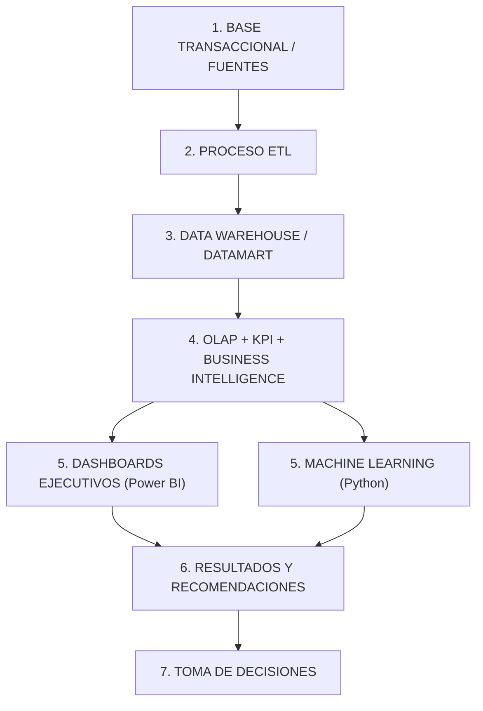

# 01. REQUERIMIENTOS OFICIALES DEL PROFESOR
**Curso:** Gestión y Análisis de Datos e Información (2026)  
**Docente:** Mg. Ing. Ivan Crispin Sanchez  
**Institución:** Universidad Nacional Federico Villarreal (UNFV) – Facultad de Ingeniería Electrónica e Informática (FIEI)  
**Documento base analizado:** `DOC-20261006-WA0030.pdf` / `Proyecto_Final_GADI_IA_2026.docx`

---

## 1. Propósito y Reto Central del Proyecto
El proyecto integrador avanzado exige diseñar e implementar una plataforma inteligente de gestión y análisis de datos para la toma de decisiones empresariales.
* **Superar el enfoque tradicional de reportes:** No basta con presentar dashboards descriptivos o reportes estáticos en Excel.
* **Módulo obligatorio de Inteligencia Artificial (IA / Machine Learning):** Debe estar directamente integrado al sistema de análisis de datos y apoyar una decisión concreta de negocio.
* **Caso empresarial asignado / seleccionado:** **Educación Superior** — *"Predicción del riesgo de desaprobación o abandono estudiantil"*.

---

## 2. Arquitectura Oficial Exigida por la Cátedra
El docente establece un flujo de datos secuencial y estricto de 6 etapas:

---

## 3. Condiciones Mínimas para Considerar el Proyecto Completo
1. **Problema empresarial claramente definido:** Con justificación cuantitativa y cualitativa.
2. **Trazabilidad de datos:** Desde la fuente cruda (CSV/plano) hasta el indicador final en el dashboard.
3. **DataMart alineado a preguntas de negocio:** El modelo dimensional debe responder a preguntas concretas de gestión.
4. **KPIs estratégicos:** Relacionados con los objetivos de la organización.
5. **Módulo de IA justificado y comparativo:** Obligatoriamente debe comparar al menos dos algoritmos con métricas técnicas (no apreciación visual).
6. **Integración BI + IA:** Los resultados o predicciones del modelo de Machine Learning deben almacenarse en la base analítica y visualizarse en el Dashboard.
7. **Principio Rector:** *"NO BASTA CON IMPLEMENTAR IA. La IA debe resolver un problema empresarial, utilizar datos adecuadamente, ser evaluada con criterios técnicos y aportar información útil para la toma de decisiones."*

---

## 4. Rúbrica de Calificación (20 Puntos)

| Criterio | Descripción según la pauta docente | Puntaje Máximo |
| :--- | :--- | :---: |
| **1. Comprensión del problema y negocio** | Problema, objetivos, procesos AS-IS/TO-BE y preguntas de negocio. | **2 pts** |
| **2. Diseño de datos y DataMart** | Modelo dimensional, granularidad, dimensiones, hechos y consistencia. | **3 pts** |
| **3. ETL e integración de datos** | Extracción, transformación, carga, calidad y actualización (SSIS). | **2 pts** |
| **4. OLAP, KPI y BI** | Indicadores, análisis, cubos/consultas multidimensionales y dashboards. | **3 pts** |
| **5. Machine Learning / IA** | Preparación, selección, entrenamiento y evaluación comparativa del modelo. | **4 pts** |
| **6. Integración BI + IA** | Uso efectivo de los resultados de IA dentro de la solución y apoyo a decisiones. | **2 pts** |
| **7. Interpretación y recomendaciones** | Capacidad para convertir resultados analíticos en conocimiento y acciones operativas. | **2 pts** |
| **8. Sustentación y defensa** | Demostración en vivo, dominio técnico, respuestas y capacidad de análisis. | **2 pts** |
| **TOTAL** | | **20 pts** |

---

## 5. Reto Adicional de Mayor Dificultad: Análisis What-If
El docente contempla componentes de simulación de escenarios:
* El usuario debe poder modificar variables clave (por ejemplo: umbral de corte de riesgo de la IA o porcentaje de alumnos intervenidos) y observar en tiempo real cómo cambia el resultado proyectado o la asignación de tutores.

---

## 6. Estructura Oficial del Informe Final

* **Introducción:** Presentación, problema, importancia y alcance.
* **CAPÍTULO I: GENERALIDADES:**
  * Descripción de la empresa u organización.
  * Historia, misión, visión y valores.
  * Organización y organigrama.
  * Área involucrada.
  * Descripción del proceso actual.
  * **Diagrama AS-IS.**
  * **Propuesta TO-BE.**
* **CAPÍTULO II: PROYECTO O TAREA ACADÉMICA (Marco Teórico formal con APA):**
  * Inteligencia de negocios (BI).
  * Data Warehouse y DataMart.
  * Modelos dimensionales.
  * Datos, información y conocimiento.
  * Dimensiones, medidas, jerarquías y granularidad.
  * Cubos OLAP.
  * Indicadores de gestión y KPI.
  * Machine Learning e Inteligencia Artificial.
* **CAPÍTULO III: DESARROLLO DE LA SOLUCIÓN:**
  * Análisis de requerimientos y preguntas de negocio.
  * Modelo conceptual, análisis OLTP, nivel de granularidad.
  * Modelo lógico del DataMart (tablas de hechos y dimensiones).
  * Proceso ETL documentado (SSIS en Visual Studio).
  * Implementación OLAP (SSAS) y campos calculados / KPI.
  * Módulo de Machine Learning (comparación de modelos y métricas).
  * Integración BI + IA y diseño de dashboards en Power BI.
  * Resultados, recomendaciones y simulación What-If.
* **Conclusiones, Sugerencias y Referencias Bibliográficas (APA 7ma ed., 15-20% en inglés).**

---

## 7. Requerimiento Inmediato: Entrega Fase 1 (Hasta el Capítulo II)
Para la primera entrega del curso, el entregable es el documento académico redactado formalmente cubriendo **Introducción, Capítulo I y Capítulo II**.  
Esta entrega sustenta la **problemática real, el diseño del negocio (AS-IS vs. TO-BE) y la fundamentación teórica de todas las decisiones de ingeniería** que se implementarán en el Capítulo III.
